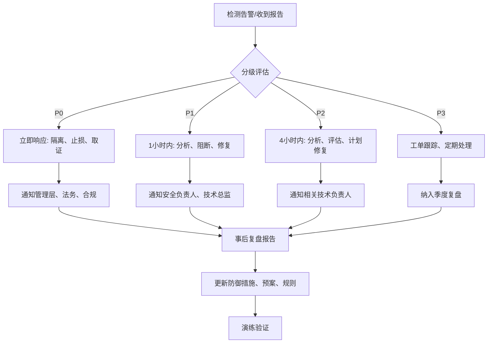

# Kubo Platform Security Guide

> **Version**: 1.0
> **Status**: 🟢 Active
> **Last Updated**: 2026-08-02
**Compliance**: 等保三级、GDPR、ISO 27001 基线

---

## 🛡️ Security Architecture

```
┌─────────────────────────────────────────────────────────────────────────────┐
                            Security Defense Layers
└─────────────────────────────────────────────────────────────────────────────┘

Layer 1: Perimeter (边界防护)
├── CloudFlare WAF (DDoS、Bot、SQLi、XSS 防护)
├── Nginx 限流、IP 黑白名单、请求大小限制
└── DNSSEC、CAAC 验证

Layer 2: Network (网络安全)
├── VPC 隔离、Security Group 最小权限
├── Kubernetes NetworkPolicy 默认拒绝
├── Service Mesh mTLS (可选)
└── 东西向流量加密

Layer 3: Application (应用安全)
├── 认证授权 (OAuth2.1 + JWT + RBAC + ABAC)
├── 行级/列级权限控制
├── 输入验证、输出编码、CSP
├── API 安全 (限流、熔断、审计)
└── 安全编码规范 (OWASP Top 10 防护)

Layer 4: Data (数据安全)
├── 传输加密 (TLS 1.3)
├── 静态加密 (AES-256-GCM)
├── 敏感字段脱敏、加密存储
├── 数据分类分级、生命周期管理
└── 备份加密、销毁规范

Layer 5: Operations (运维安全)
├── 账号权限最小化、定期轮换
├── 操作审计、异常告警
├── 漏洞管理、补丁管理
├── 应急响应、演练机制
└── 供应链安全 (SBOM、依赖扫描)
```

---

## 🔐 Authentication & Authorization

### 认证体系

```yaml
# 认证流程
Authentication Flow:
  1. 用户提交凭证 (用户名/密码/验证码/生物识别)
  2. Auth Service 验证 -> 颁发 Access Token (JWT, 15min) + Refresh Token (7天)
  3. 客户端携带 Access Token 访问资源
  4. 网关/服务验证 JWT (签名、过期、受众、签发者)
  4. Access Token 过期 -> 使用 Refresh Token 换新 (自动、无感)
  5. Refresh Token 过期 -> 重新登录

# Token 规范
JWT Claims:
  - iss: "kubo-auth"
  - sub: userId
  - aud: "kubo-api"
  - exp: 15min
  - iat: issued at
  - jti: unique token id
  - tenant_id: 租户 ID
  - roles: ["ROLE_WMS_ADMIN", "ROLE_FINANCE_USER"]
  - permissions: ["inventory:read", "inventory:write"]

# Refresh Token
  - 存储: Redis (Hash: userId -> {token, deviceId, expiresAt})
  - 轮换: 使用一次失效、颁发新 Refresh Token
  - 撤销: 登出、修改密码、管理员强制下线 -> 删除 Redis 记录
```

### 授权模型 (RBAC + ABAC)

```yaml
# 角色定义
Roles:
  - ROLE_SUPER_ADMIN: 全平台超级管理员
  - ROLE_TENANT_ADMIN: 租户管理员
  - ROLE_WMS_ADMIN: 仓储管理员
  - ROLE_WMS_OPERATOR: 仓储操作员
  - ROLE_FINANCE_ADMIN: 财务管理员
  - ROLE_READONLY: 只读查看

# 权限标识格式: {module}:{resource}:{action}
Permissions:
  - wms:inventory:read
  - wms:inventory:write
  - wms:inventory:delete
  - wms:inventory:export
  - mes:workorder:read
  - mes:workorder:write
  - finance:voucher:read
  - finance:voucher:write
  - system:user:read
  - system:user:write

# 行级权限 (数据隔离)
Data Permissions:
  - 维度: 租户、仓库、车间、部门、项目
  - 规则: 用户只能访问授权维度内的数据
  - 实现: MyBatis-Plus 拦截器注入 WHERE 条件

# 列级权限 (字段脱敏)
Column Permissions:
  - 敏感字段: 手机号、身份证、银行卡、薪资、成本价
  - 脱敏策略: PARTIAL(部分)、REDACT(全隐)、HASH、LAST4
  - 白名单角色: 可查看明文
```

### 实现规范

```java
// Controller 权限注解
@Tag(name = "库存管理")
@RestController
@RequestMapping("/api/v1/inventory")
public class InventoryController {

    @Operation(summary = "库存扣减")
    @PostMapping("/deduct")
    @RequirePermission("wms:inventory:write")  // 接口级权限
    public Result<Void> deduct(
            @RequestHeader("Idempotency-Key") String idempotencyKey,
            @Valid @RequestBody InventoryDeductCmd cmd) {
        return inventoryService.deduct(cmd, idempotencyKey);
    }
}

// Service 行级权限 (自动注入 WHERE)
@Service
public class InventoryService {
    public Page<InventoryVO> page(InventoryQuery query) {
        // DataPermissionInterceptor 自动注入:
        // WHERE tenant_id = ? AND warehouse_id IN (用户授权仓库列表)
        return repository.page(query);
    }
}

// Entity 列级脱敏（J3 起实体只标 MyBatis-Plus 注解：列名 = 驼峰转下划线，@TableField 只在显式改名时用）
@Data
@TableName("employee")
public class EmployeeEntity extends BaseEntity<EmployeeEntity> {
    @Description("手机号")
    @SensitiveField(mask = MaskStrategy.PARTIAL, rolesAllowed = {"ROLE_HR_ADMIN", "ROLE_SUPER_ADMIN"})
    private String phone;

    @Description("身份证")
    @SensitiveField(mask = MaskStrategy.REDACT, rolesAllowed = {"ROLE_HR_ADMIN"})
    private String idCard;
}
```

---

## 🔒 Data Protection

### 敏感数据分类

| 级别 | 定义 | 示例 | 保护要求 |
|------|------|------|----------|
| **L4 - 绝密** | 核心商业机密、密钥 | 加密密钥、签名私钥、核心算法 | 硬件加密模块(HSM)、离线存储、双人授权 |
| **L3 - 机密** | 个人敏感信息、财务核心 | 身份证、银行卡、薪资、成本价、利润率 | AES-256 加密存储、传输加密、列级脱敏、审计 |
| **L2 - 内部** | 业务运营数据 | 客户姓名、手机号、邮箱、订单详情 | 访问控制、脱敏展示、操作审计 |
| **L1 - 公开** | 公开发布信息 | 产品宣传、公开价格、公司地址 | 完整性保护、防篡改 |

### 加密规范

```yaml
# 传输加密
Transport Encryption:
  - 外部 API: TLS 1.3 (强制)、HSTS、Certificate Pinning
  - 内部服务间: mTLS (Istio) 或 TLS 1.2+
  - 数据库连接: MySQL SSL (verifyServerCertificate=true)
  - Redis: TLS 1.2 (可选，内网可关闭)
  - MQ: RabbitMQ TLS 1.2
  - 文件传输: HTTPS/SFTP、预签名 URL (MinIO)

# 静态加密
At-Rest Encryption:
  - 数据库: MySQL TDE (透明加密) + 列级加密
  - Redis: 不加密 (内存)、RDB/AOF 磁盘加密
  - 对象存储: MinIO SSE-S3 (AES-256) / SSE-KMS
  - 备份: AES-256-GCM + 独立密钥管理
  - 日志: 敏感字段脱敏写入

# 密钥管理
Key Management:
  - 主密钥: AWS KMS / HashiCorp Vault / 阿里云 KMS
  - 数据密钥: DEK (每表/每列独立) -> KEK 加密存储
  - 轮换: DEK 90天、KEK 180天、主密钥 365天
  - 分离: 加密密钥与数据分离存储
  - 审计: 所有密钥操作记录不可篡改
```

### 脱敏实现

```java
// 脱敏策略枚举
public enum MaskStrategy {
    REDACT("****"),           // 全隐藏
    PARTIAL("138****1234"),   // 部分显示 (前3后4)
    LAST4("****1234"),        // 仅后4位
    FIRST2("13********"),     // 仅前2位
    HASH("sha256:abcd..."),   // 哈希值
    NONE("原值");             // 白名单可见

    private final String example;
}

// 脱敏注解
@Target({FIELD, METHOD})
@Retention(RUNTIME)
public @interface SensitiveField {
    MaskStrategy mask() default MaskStrategy.PARTIAL;
    String[] rolesAllowed() default {};  // 白名单角色
    String category() default "PII";     // PII/FINANCIAL/CREDENTIAL
}

// 脱敏切面 (AOP)
@Aspect
@Component
@Order(Ordered.HIGHEST_PRECEDENCE)
public class ColumnMaskingAspect {

    @Around("@annotation(sensitiveField) || @within(sensitiveField)")
    public Object maskIfNeeded(ProceedingJoinPoint pjp, SensitiveField sensitiveField) {
        Object result = pjp.proceed();
        if (result == null) return null;

        Authentication auth = SecurityContextHolder.getContext().getAuthentication();
        if (hasAllowedRole(auth, sensitiveField.rolesAllowed())) {
            return result; // 白名单穿透
        }

        return maskObject(result, sensitiveField.mask());
    }
}

// 脱敏工具
public class MaskUtils {
    public static String maskPhone(String phone) {
        if (StrUtil.isBlank(phone) || phone.length() < 7) return "****";
        return phone.substring(0, 3) + "****" + phone.substring(phone.length() - 4);
    }

    public static String maskIdCard(String idCard) {
        if (StrUtil.isBlank(idCard) || idCard.length() < 10) return "****************";
        return idCard.substring(0, 6) + "********" + idCard.substring(idCard.length() - 4);
    }

    public static String maskBankCard(String card) {
        if (StrUtil.isBlank(card) || card.length() < 8) return "****";
        return "**** **** **** " + card.substring(card.length() - 4);
    }

    public static String maskEmail(String email) {
        if (StrUtil.isBlank(email) || !email.contains("@")) return "****";
        String[] parts = email.split("@");
        String name = parts[0];
        if (name.length() <= 2) return "**@" + parts[1];
        return name.substring(0, 1) + "***" + name.substring(name.length() - 1) + "@" + parts[1];
    }
}
```

---

## 🌐 API Security

### 安全头规范

```nginx
# Nginx / Gateway 安全头
add_header X-Frame-Options "DENY" always;
add_header X-Content-Type-Options "nosniff" always;
add_header X-XSS-Protection "1; mode=block" always;
add_header Referrer-Policy "strict-origin-when-cross-origin" always;
add_header Content-Security-Policy "default-src 'self'; script-src 'self' 'unsafe-inline' 'unsafe-eval'; style-src 'self' 'unsafe-inline'; img-src 'self' data: https:; font-src 'self' data:; connect-src 'self' https:; frame-ancestors 'none';" always;
add_header Strict-Transport-Security "max-age=31536000; includeSubDomains; preload" always;
add_header Permissions-Policy "geolocation=(), microphone=(), camera=()" always;
```

### 限流规范

```yaml
Rate Limiting:
  # 用户级
  User:
    - 登录/注册: 5 req/min/IP
    - 密码修改: 3 req/15min/user
    - 通用 API: 1000 req/min/user
    - 核心写接口: 100 req/min/user

  # IP 级
  IP:
    - 通用: 5000 req/min/IP
    - 登录页: 20 req/min/IP

  # 租户级
  Tenant:
    - 总配额: 10000 req/min/tenant
    - 突发: 20000 req/min/tenant

  # 接口级 (关键写接口)
  Critical Endpoints:
    - 库存扣减: 500 req/min
    - 订单创建: 200 req/min
    - 支付回调: 1000 req/min

  # 实现: Redis Sliding Window + Lua 脚本
  # 响应头:
  #   RateLimit-Limit: 1000
  #   RateLimit-Remaining: 999
  #   RateLimit-Reset: 1722489600
```

### 输入验证

```java
// 统一验证规范
@RestController
@RequestMapping("/api/v1/inventory")
@Validated
public class InventoryController {

    @PostMapping
    public Result<InventoryVO> create(
            @RequestHeader("Idempotency-Key") String idempotencyKey,
            @Valid @RequestBody InventoryCreateCmd cmd) {  // JSR-303 验证
        return inventoryService.create(cmd);
    }
}

// DTO 验证注解
@Data
@Schema(name = "InventoryCreateCmd")
public class InventoryCreateCmd {

    @NotNull(message = "仓库不能为空")
    @Schema(description = "仓库 ID", requiredMode = REQUIRED)
    private Long warehouseId;

    @NotNull(message = "物料不能为空")
    @Schema(description = "物料 ID", requiredMode = REQUIRED)
    private Long materialId;

    @NotNull(message = "数量不能为空")
    @DecimalMin(value = "0.000001", message = "数量必须大于 0")
    @Digits(integer = 14, fraction = 6, message = "数量格式错误")
    @Schema(description = "可用数量", requiredMode = REQUIRED)
    private BigDecimal availableQty;

    @DecimalMin(value = "0", message = "预警阈值不能为负")
    @Schema(description = "预警阈值")
    private BigDecimal warningThreshold;

    @Size(max = 500, message = "备注最多 500 字符")
    @Schema(description = "备注")
    private String remark;
}

// 参数校验失败 / 业务错误：不手写 GlobalExceptionHandler 与 Result.error(...)。
// 框架层由 airpower Errors 统一处理（项目已 `import static cn.hamm.airpower.exception.Errors.PARAM_INVALID` 使用）；
// 业务层统一登记在 CustomError 枚举并抛 `ServiceException`，由框架异常拦截器写回统一 code。
@RestControllerAdvice
public class GlobalExceptionHandler {

    @ExceptionHandler(MethodArgumentNotValidException.class)
    public Result<Void> handleValidation(MethodArgumentNotValidException e) {
        String msg = e.getBindingResult().getFieldErrors().stream()
            .map(fe -> fe.getField() + ": " + fe.getDefaultMessage())
            .collect(Collectors.joining("; "));
        throw new ServiceException(Errors.PARAM_INVALID.getCode(), msg);
    }
}
```

---

## 🔍 Security Monitoring & Audit

### 审计日志

```java
// 审计事件定义
public enum AuditAction {
    LOGIN, LOGOUT, LOGIN_FAILED,
    CREATE, READ, UPDATE, DELETE,
    PUBLISH, APPROVE, REJECT,
    EXPORT, IMPORT,
    PERMISSION_GRANT, PERMISSION_REVOKE,
    CONFIG_CHANGE, PASSWORD_CHANGE
}

// 审计实体（J3 起：表名 @TableName，索引/唯一键一律写进 infra/init-sql/init.sql —— 注解里不再有第二份 schema）
@Data
@TableName("audit_log")
public class AuditLogEntity extends BaseEntity<AuditLogEntity> {
    private Long tenantId;
    private Long userId;
    private String username;
    private AuditAction action;
    private String resourceType;
    private Long resourceId;
    private String requestIp;
    private String userAgent;
    private String requestParams;  // 脱敏后
    private String responseData;   // 脱敏后
    private Integer status;        // 200/4xx/5xx
    private String errorMessage;
    private Long costTimeMs;
    private LocalDateTime createdAt;
}

// 自动审计切面
@Aspect
@Component
public class AuditLogAspect {

    @Around("@annotation(auditLog) || @within(auditLog)")
    public Object audit(ProceedingJoinPoint pjp, AuditLog auditLog) {
        long start = System.currentTimeMillis();
        AuditLogEntity audit = buildAuditLog(pjp, auditLog);
        try {
            Object result = pjp.proceed();
            audit.setStatus(200);
            audit.setResponseData(maskSensitive(result));
            return result;
        } catch (Exception e) {
            audit.setStatus(resolveHttpStatus(e));
            audit.setErrorMessage(e.getMessage());
            throw e;
        } finally {
            audit.setCostTimeMs(System.currentTimeMillis() - start);
            auditLogService.asyncSave(audit);
        }
    }
}
```

### 安全告警规则

```yaml
# Prometheus 告警规则
groups:
  - name: security-alerts
    rules:
      # 认证异常
      - alert: HighFailedLoginAttempts
        expr: rate(auth_login_failed_total[5m]) > 10
        for: 2m
        labels:
          severity: warning
          team: security
        annotations:
          summary: 登录失败频率异常
          description: 每分钟登录失败超过 10 次，可能存在暴力破解

      - alert: BruteForceAttack
        expr: increase(auth_login_failed_total[15m]) > 50
        for: 1m
        labels:
          severity: critical
          team: security
        annotations:
          summary: 疑似暴力破解攻击
          description: 15分钟内登录失败超过 50 次

      # 授权异常
      - alert: HighUnauthorizedAccess
        expr: rate(http_server_requests_seconds_count{status="403"}[5m]) > 50
        for: 5m
        labels:
          severity: warning
          team: security
        annotations:
          summary: 非授权访问异常

      # 敏感操作
      - alert: MassDataExport
        expr: rate(audit_log_total{action="EXPORT"}[5m]) > 10
        for: 1m
        labels:
          severity: warning
          team: security
        annotations:
          summary: 大量数据导出
          description: 5分钟内导出操作超过 10 次

      - alert: PermissionEscalation
        expr: rate(audit_log_total{action=~"PERMISSION_GRANT|ROLE_ASSIGN"}[5m]) > 20
        for: 2m
        labels:
          severity: critical
          team: security
        annotations:
          summary: 权限提升异常

      # 数据异常
      - alert: AnomalousDataAccess
        expr: rate(audit_log_total{action="READ",status=~"2.."}[5m]) > 1000
        for: 5m
        labels:
          severity: warning
          team: security
        annotations:
          summary: 异常数据访问量
```

---

## 🛡️ Secure Coding Checklist

### OWASP Top 10 Prevention

| Risk | Prevention | Implementation |
|------|------------|----------------|
| **A01: Broken Access Control** | RBAC + 行级权限 + 接口级注解 | `@RequirePermission` + MyBatis 拦截器 |
| **A02: Cryptographic Failures** | TLS 1.3 + AES-256 + 密钥轮换 | TLS 1.3 强制、MySQL TDE、Vault 管理密钥 |
| **A03: Injection** | 参数化查询、输入验证、ORM | MyBatis `#{}`、JSR-303、WAF |
| **A04: Insecure Design** | 威胁建模、安全设计评审 | ADR 记录、安全设计文档 |
| **A05: Security Misconfiguration** | 安全基线、自动化扫描 | CIS Benchmark、kube-bench、Trivy |
| **A06: Vulnerable Components** | 依赖扫描、自动更新 | Dependabot、OWASP Dependency-Check、Trivy |
| **A07: Authentication Failures** | MFA、限流、账户锁定 | 限流、账户锁定、MFA 支持 |
| **A08: Software/Data Integrity** | 签名验证、SBOM、供应链安全 | Cosign 签名、SBOM 生成、私有仓库 |
| **A09: Logging/Monitoring Failures** | 统一日志、实时告警、审计 | 结构化日志、Prometheus 告警、审计日志 |
| **A10: SSRF** | URL 白名单、网络隔离 | 出站代理、网络策略、URL 白名单 |

### Code Review Security Focus

```markdown
# Security Code Review Checklist

## 认证授权
- [ ] 所有接口有权限注解
- [ ] 敏感操作有二次确认/审批
- [ ] Token 刷新机制安全
- [ ] 会话管理安全 (并发、超时、注销)

## 输入验证
- [ ] 所有输入参数验证 (JSR-303)
- [ ] 文件上传类型/大小/内容验证
- [ ] SQL 注入防护 (参数化查询)
- [ ] XSS 防护 (输出编码、CSP)

## 数据保护
- [ ] 敏感字段脱敏/加密
- [ ] 传输加密 (TLS 1.3)
- [ ] 日志不记录敏感信息
- [ ] 错误信息不泄露内部细节

## 会话管理
- [ ] Token 过期、刷新、撤销机制
- [ ] 并发会话控制
- [ ] 跨站请求伪造 (CSRF) 防护

## 错误处理
- [ ] 统一错误码、不泄露堆栈
- [ ] 业务异常 vs 系统异常区分
- [ ] 熔断降级不暴露内部错误

## 依赖管理
- [ ] 无高危漏洞依赖
- [ ] 依赖版本锁定
- [ ] 供应链安全 (SBOM、签名)
```

---

## 🚨 Incident Response

### 安全事件分级

| 级别 | 定义 | 响应时间 | 升级路径 | 示例 |
|------|------|----------|----------|------|
| **P0 - 紧急** | 核心业务中断、数据泄露、大面积入侵 | 15 分钟 | 立即通知 CTO/CISO、启动应急预案 | 数据库被拖库、勒索软件、核心服务瘫痪 |
| **P1 - 高危** | 关键漏洞利用、权限提升、大量异常访问 | 1 小时 | 通知安全负责人、技术总监 | 0day 漏洞被利用、管理员账号被盗 |
| **P2 - 中危** | 疑似攻击、异常流量、配置错误暴露 | 4 小时 | 通知安全运营、相关技术负责人 | 疑似暴力破解、配置错误暴露内网 |
| **P3 - 低危** | 低级别告警、合规偏差、潜在风险 | 24 小时 | 工单跟踪、定期复盘 | 弱密码策略、过期证书、审计日志缺失 |

### 响应流程



### 应急预案模板

```markdown
# 应急预案: 数据库泄露

## 触发条件
- 发现数据库数据在暗网/公网泄露
- 收到外部通报/安全厂商通报
- 审计日志发现异常大量数据导出

## 响应步骤
1. **止损 (0-30min)**
   - 立即撤销疑似泄露账号权限
   - 切换数据库访问白名单
   - 启用增强审计模式

2. **评估 (30min-2h)**
   - 确认泄露范围: 表、行数、字段、时间范围
   - 确认泄露原因: SQL注入、内部泄露、备份丢失、配置错误
   - 评估影响级别: P0/P1/P2

3. **修复 (2h-24h)**
   - 修复根因漏洞
   - 轮换所有相关密钥/密码
   - 补全缺失审计/加密/脱敏

4. **通报 (依法规)**
   - 72小时内向监管部门报告 (GDPR/个保法)
   - 通知受影响用户
   - 内部复盘会议

## 恢复验证
- 渗透测试验证修复
- 数据完整性校验
- 监控告警规则更新

## 复盘输出
- 根因分析报告 (RCA)
- 时间线梳理
- 改进措施清单
- 预案更新
```

---

## 📋 Compliance Checklist

| Standard | Requirement | Implementation Status |
|----------|-------------|----------------------|
| **等保三级** | 身份鉴别、访问控制、安全审计、入侵防范、恶意代码防范 | 🟢 进行中 |
| **GDPR** | 数据最小化、用户同意、删除权、可携带权、DPIA | 🟡 规划中 |
| **ISO 27001** | 信息安全管理体系、风险评估、持续改进 | 🟡 规划中 |
| **个保法 (中国)** | 个人信息收集最小化、明示目的、安全保护、主体权利 | 🟢 进行中 |
| **PCI DSS** (如涉及支付) | 网络安全、持卡人数据保护、漏洞管理、访问控制、监控测试 | ⚪ 不适用 |

---

## 📚 References

- [OWASP Top 10 2021](https://owasp.org/Top10/)
- [OWASP ASVS 4.0](https://owasp.org/www-project-application-security-verification-standard/)
- [NIST Cybersecurity Framework](https://www.nist.gov/cyberframework)
- [中国网络安全等级保护 2.0 标准](http://www.tc260.org.cn/)
- [个人信息保护法](http://www.npc.gov.cn/)
- [数据安全法](http://www.npc.gov.cn/)
- [CIS Kubernetes Benchmark](https://www.cisecurity.org/benchmark/kubernetes)
- [HashiCorp Vault Best Practices](https://www.vaultproject.io/docs)

---

*Last Updated: 2026-08-02*
*Classification: Internal - Security Sensitive*
*Review Cycle: Quarterly*
