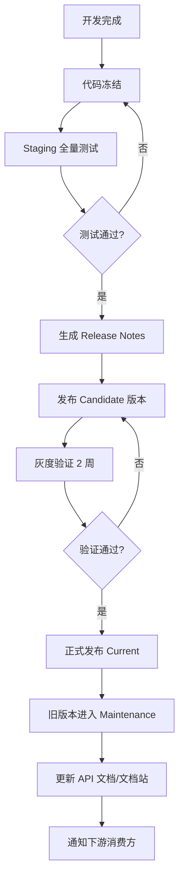

# API 版本管理策略

> **版本**：v1.0
> **状态**：🟢 已定稿，强制执行
> **适用范围**：Kubo 平台所有对外 API (REST)。~~gRPC / Dubbo / WebSocket~~ —— 这三种通道**均未落地**
> （gRPC 与 Dubbo 从未采用；WebSocket 通道与聊天模块已于 2026-09-17 整体移除，协议文档一并删除）。

---

## 1. 版本管理策略概述

### 1.1 版本号格式

采用 **语义化版本 + API 版本前缀** 双重版本控制：

```
API 版本: v{MAJOR}          (URL 路径前缀: /api/v1/, /api/v2/)
实现版本: {MAJOR}.{MINOR}.{PATCH} (语义化版本, 如 1.2.3)
```

| 版本层级 | 格式 | 示例 | 变更触发条件 |
|----------|------|------|--------------|
| **API 大版本** | `v{MAJOR}` | `v1`, `v2` | **Breaking Change** (不兼容变更) |
| **功能小版本** | `{MAJOR}.{MINOR}` | `1.1`, `1.2` | 新增功能、字段、接口 (向后兼容) |
| **补丁版本** | `{MAJOR}.{MINOR}.{PATCH}` | `1.2.1`, `1.2.2` | Bug 修复、性能优化、文档更新 (完全兼容) |

---

## 2. API 版本传递方式

### 2.1 REST API

| 方式 | 格式 | 优先级 | 示例 |
|------|------|--------|------|
| **URL 路径前缀** (强制) | `/api/v{MAJOR}/...` | 最高 | `GET /api/v1/inventory/page` |
| Header 补充 | `X-API-Version: 1` | 备选 | 兼容旧客户端 |

**强制规范**：
- 所有 REST 接口**必须**在 URL 路径包含大版本号：`/api/v1/...`
- 禁止使用 Header 作为唯一版本标识
- API 网关根据路径前缀路由到对应版本服务

### 2.2 Dubbo/gRPC 服务 —— ⛔ 已移除的技术栈

> 两种 RPC 通道**从未在本仓落地**（无依赖、无服务定义、无调用方），相关实现方案不再有效。
> 若将来引入，版本传递规则需重新评估后写入本节。

### 2.3 WebSocket —— ⛔ 已移除的技术栈

> WebSocket 通道与聊天模块已于 2026-09-17 整体移除（前端 `src/websocket/`、后端 `AppWebSocketHandler`、
> nginx `/websocket` 反代、`WEBSOCKET_PROTOCOL.md` 全部删除）。实时能力如重新立项，再补本节。

---

## 3. 版本生命周期管理

### 3.1 版本状态定义

| 状态 | 定义 | 支持策略 |
|------|------|----------|
| **Current** | 当前主推版本 | 全功能支持、新功能开发、Bug 修复、安全补丁 |
| **Maintenance** | 维护期版本 | 仅关键 Bug 修复、安全补丁，不再新增功能 |
| **Deprecated** | 废弃版本 | 仅安全补丁，不再接受新接入 |
| **Sunset** | 停用版本 | 完全停止服务，流量强制迁移 |

### 3.2 版本生命周期时间表

| 阶段 | 持续时间 | 说明 |
|------|----------|------|
| **Current** | 18 个月 | 主版本发布后 18 个月为 Current |
| **Maintenance** | 12 个月 | Current 结束后进入 12 个月维护期 |
| **Deprecated** | 6 个月 | Maintenance 结束后 6 个月废弃期 |
| **Sunset** | 即时 | Deprecated 结束后立即停用 |

**总生命周期**：36 个月 (3 年)

### 3.3 版本共存策略

| 场景 | 最大共存版本数 | 策略 |
|------|----------------|------|
| **正常运行** | 2 个大版本 | `vN` (Current) + `vN-1` (Maintenance) |
| **平滑迁移期** | 3 个大版本 | 发布新版本后 6 个月过渡期 |
| **紧急安全修复** | 3 个大版本 | 同时向 Current/Maintenance/Deprecated 推送安全补丁 |

---

## 4. 变更分类与版本号递增规则

### 4.1 Breaking Changes (大版本 +1)

| 变更类型 | 示例 | 处理要求 |
|----------|------|----------|
| **删除/重命名** 接口/字段/枚举值 | 删除 `/api/v1/inventory/export` | 大版本 +1，旧版本进入 Maintenance |
| **修改** 接口签名/参数类型/必填项 | `pageSize` 从 `Integer` 改为 `Long` | 大版本 +1 |
| **修改** 错误码/错误信息格式 | 错误码 `201001` → `200101` | 大版本 +1 |
| **删除/修改** 枚举值含义 | `STATUS=1` 从 "启用" 改为 "正常" | 大版本 +1 |
| **修改** 业务规则导致不兼容 | 订单状态流转规则变更 | 大版本 +1 |
| **修改** 认证/授权机制 | JWT 算法从 HS256 改 RS256 | 大版本 +1 |

### 4.2 兼容性新增 (小版本 +1)

| 变更类型 | 示例 | 处理要求 |
|----------|------|----------|
| **新增** 接口/字段/枚举值 | 新增 `/api/v1/inventory/batch-export` | 小版本 +1 |
| **新增** 可选查询参数 | 新增 `?includeDeleted=true` | 小版本 +1 |
| **新增** 响应字段 | 响应新增 `createdByName` 字段 | 小版本 +1 |
| **新增** 枚举值 | 新增 `STATUS=3` 表示 "归档" | 小版本 +1 |
| **放宽** 参数校验 | `pageSize` 最大值 100 → 500 | 小版本 +1 |
| **新增** 错误码 (不影响现有) | 新增 `201010` 密码过期 | 小版本 +1 |

### 4.3 完全兼容 (补丁版本 +1)

| 变更类型 | 示例 | 处理要求 |
|----------|------|----------|
| **Bug 修复** | 修复分页总数计算错误 | 补丁版本 +1 |
| **性能优化** | SQL 优化、缓存命中率提升 | 补丁版本 +1 |
| **文档更新** | Swagger 注释完善 | 补丁版本 +1 |
| **日志/监控** 增强 | 新增链路追踪埋点 | 补丁版本 +1 |
| **配置调整** | 超时时间 3s → 5s | 补丁版本 +1 |

---

## 5. 版本发布与废弃流程

### 5.1 新版本发布流程



### 5.2 版本废弃通知流程

| 时间节点 | 动作 | 通知对象 | 通知渠道 |
|----------|------|----------|----------|
| **T-6 个月** | 发布废弃公告 | 所有消费方 | 邮件、钉钉、文档站公告 |
| **T-3 个月** | 二次提醒 + 迁移指南 | 仍在使用旧版的消费方 | 邮件、钉钉、工单 |
| **T-1 个月** | 最终通知 + 截止日期 | 仍在使用旧版的消费方 | 电话、邮件、工单升级 |
| **T-0** | 正式停用 | - | 监控告警、流量强制切换 |

### 5.3 废弃响应头规范

```http
# 对废弃版本的响应必须包含
Deprecation: true
Sunset: Sat, 01 Jan 2027 00:00:00 GMT
Link: <https://api.kubo.example.com/api/v2/>; rel="successor-version"
Warning: 299 - "API v1 is deprecated, will sunset on 2027-01-01. Please migrate to v2."
```

---

## 6. 客户端兼容性要求

### 6.1 前端 SDK 版本对应表

| API 版本 | 前端 SDK 版本范围 | 支持状态 |
|----------|-------------------|----------|
| `v2` | `^2.0.0` | Current |
| `v1` | `^1.0.0` | Maintenance |
| `v0` | `< 1.0.0` | Deprecated |

### 6.2 客户端升级策略

| 策略 | 适用场景 | 实施方式 |
|------|----------|----------|
| **强制升级** | 安全漏洞、核心 Bug | 应用启动检测版本，强制更新 |
| **引导升级** | 功能优化、新特性 | 应用内提示、应用商店更新 |
| **兼容运行** | 兼容性新增 | 无感知，自动兼容 |

---

## 6. 文档与契约管理

### 6.1 文档版本对应

| 文档 | 版本管理方式 |
|------|--------------|
| **OpenAPI 文档** | 每个大版本独立文档：`/v1/api-docs`, `/v2/api-docs` |
| **API 文档站** | 版本切换器：`/docs/v1/`, `/docs/v2/` |
| **Postman Collection** | 版本前缀：`Kubo API v1.postman_collection.json` |
| **SDK 文档** | 版本前缀：`sdk-v1.md`, `sdk-v2.md` |

### 6.2 契约测试

```yaml
# 契约测试策略
contract_testing:
  provider: Spring Cloud Contract
  consumer: Pact
  base_class: ContractTestBase
  contracts_dir: src/test/resources/contracts

  # 版本兼容性矩阵测试
  compatibility_matrix:
    - provider: v2.1.0
      consumers: [v1.0.x, v1.1.x, v2.0.x]
    - provider: v1.2.0
      consumers: [v1.0.x, v1.1.x]
```

---

## 7. 监控与治理

### 7.1 版本使用统计

| 指标 | 采集方式 | 告警阈值 |
|------|----------|----------|
| `api_version_usage{version="v1"}` | 网关统计 | v1 流量 > 10% 且持续 30 天 → 推送迁移提醒 |
| `api_version_usage{version="v0"}` | 网关统计 | > 0 → 立即告警 |
| `deprecated_api_calls_total` | 网关统计 | > 100/小时 → 推送迁移提醒 |

### 7.2 版本治理看板

| 看板 | 关键指标 |
|------|----------|
| **版本分布** | 各版本流量占比、趋势 |
| **迁移进度** | 旧版本流量下降曲线、迁移完成率 |
| **兼容性** | 契约测试通过率、Breaking Change 检测 |
| **废弃进度** | 废弃版本流量清零进度 |

---

## 8. 相关链接

- [Semantic Versioning 2.0.0](https://semver.org/lang/zh-CN/)
- [API Versioning Best Practices](https://cloud.google.com/apis/design/versioning)
- [Microsoft REST API Guidelines - Versioning](https://github.com/microsoft/api-guidelines/blob/vNext/Guidelines.md#versioning)
- [Spring Cloud Contract 文档](https://docs.spring.io/spring-cloud-contract/docs/current/reference/html/)
- [Pact 契约测试](https://docs.pact.io/)

---

*文档版本：v1.0*
*最后更新：2026-08-01*
*状态：🟢 已定稿，强制执行*
