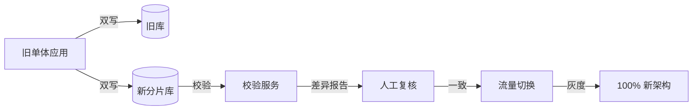

# 数据库迁移策略文档

> **版本**：v1.0  
> **状态**：🟢 已定稿，强制执行  
> **适用范围**：Kubo 平台全量数据迁移 (单体 → 微服务分库分表)  
> **迁移目标**：零停机、零数据丢失、可回滚、可验证

---

## 1. 迁移总体策略

### 1.1 迁移原则

| 原则 | 说明 |
|------|------|
| **零停机** | 业务全程可用，无感知迁移 |
| **零数据丢失** | RPO = 0，所有数据完整迁移 |
| **可回滚** | 任意时刻可秒级回滚至旧架构 |
| **可验证** | 全量/增量双重校验，差异零容忍 |
| **分批迁移** | 按业务域分批、按表分批、灰度切换 |

### 1.2 迁移架构



### 1.3 迁移分批策略

| 批次 | 业务域 | 表数量 | 预估数据量 | 风险等级 | 预计耗时 |
|------|--------|--------|------------|----------|----------|
| **第 1 批** | 系统管理 | 15 | < 10万 | 低 | 1 天 |
| **第 2 批** | 字典/配置 | 10 | < 5万 | 低 | 0.5 天 |
| **第 3 批** | 人事组织 | 20 | < 20万 | 低 | 1 天 |
| **第 4 批** | 仓储核心 | 30 | 500万+ | 高 | 3 天 |
| **第 5 批** | 制造执行 | 25 | 300万+ | 高 | 2 天 |
| **第 6 批** | 财务核算 | 20 | 100万+ | 高 | 2 天 |
| **第 7 批** | 采购/销售/资产 | 40 | 200万+ | 中 | 3 天 |
| **第 8 批** | 物联/报表/日志 | 30 | 1000万+ | 中 | 2 天 |

---

## 2. 迁移技术方案

### 2.1 双写模式架构

```java
// 双写切面示例
@Aspect
@Component
@Order(1)
public class DualWriteAspect {

    @Autowired
    private OldRepository oldRepository;
    
    @Autowired
    private NewRepository newRepository;

    @Around("@annotation(DualWrite)")
    public Object dualWrite(ProceedingJoinPoint pjp) throws Throwable {
        // 1. 执行旧库操作
        Object result = pjp.proceed();
        
        // 2. 异步写入新库 (不阻塞主流程)
        CompletableFuture.runAsync(() -> {
            try {
                replicateToNew(pjp, result);
            } catch (Exception e) {
                log.error("双写新库失败", e);
                // 记录失败，进入补偿队列
                dualWriteFailureQueue.offer(new DualWriteFailure(pjp, result, e));
            }
        });
        
        return result;
    }
}
```

### 2.2 迁移工具栈

| 工具 | 用途 | 版本 |
|------|------|------|
| **Flyway** | 版本化 Schema 迁移 | 10.15+ |
| **ShardingSphere** | 读写分离、分片路由 | 5.4+ |
| **DataX / Canal** | 全量/增量同步 | 3.0+ / 1.1.7 |
| **gh-ost / pt-osc** | 大表在线 DDL | 最新 |
| **自研校验工具** | 全量/增量数据校验 | 自研 |

### 2.3 分片规则设计

```yaml
# sharding-wms.yaml 示例
sharding:
  tables:
    inventory_flow:
      actualDataNodes: ds_${0..15}.inventory_flow_${0..11}  # 16库 x 12个月分表
      tableStrategy:
        standard:
          shardingColumn: warehouse_id
          preciseAlgorithmClassName: cn.kubo.wms.sharding.WarehouseIdShardingAlgorithm
        complex:
          shardingColumns: warehouse_id, create_time
          algorithmClassName: cn.kubo.wms.sharding.InventoryFlowComplexAlgorithm
      keyGenerateStrategy:
        column: id
        keyGeneratorClassName: cn.kubo.common.sharding.SnowflakeKeyGenerator
    
    stock_qty:
      actualDataNodes: ds_${0..15}.stock_qty
      tableStrategy:
        standard:
          shardingColumn: warehouse_id
          preciseAlgorithmClassName: cn.kubo.wms.sharding.WarehouseIdShardingAlgorithm
      keyGenerateStrategy:
        column: id
        keyGeneratorClassName: cn.kubo.common.sharding.SnowflakeKeyGenerator

  # 广播表 (字典、配置、字典项等)
  broadcastTables:
    - sys_dict
    - sys_dict_item
    - sys_config
    - sys_area
```

---

## 3. 迁移执行步骤

### Phase 1: 准备阶段 (T-2 周)

| 任务 | 负责 | 交付物 |
|------|------|--------|
| 1.1 编写 Flyway 迁移脚本 (Schema + 分片规则) | DBA | `V1.x.x__sharding_schema.sql` |
| 1.2 搭建新库集群 (InnoDB Cluster) | DBA | 集群健康检查报告 |
| 1.3 配置 ShardingSphere 分片规则 | 架构师 + DBA | `sharding-*.yaml` |
| 1.4 开发双写切面 + 补偿队列 | 后端架构 | `kubo-common-dao` 双写模块 |
| 1.5 开发全量/增量校验工具 | DBA + 后端 | `DataConsistencyChecker` |
| 1.4 编写回滚预案 | 架构师 + DBA | `ROLLBACK_PLAYBOOK.md` |

### Phase 2: 双写验证阶段 (T-1 周 ~ T+2 周)

| 步骤 | 动作 | 验收标准 |
|------|------|----------|
| 2.1 | 部署双写版本到 Staging | 双写成功率 100% |
| 2.2 | 全量历史数据同步 (DataX) | 行数一致、校验和一致 |
| 2.3 | 开启增量同步 | 延迟 < 1s |
| 2.3 | 持续校验 (每小时全量校验) | 差异 = 0 |
| 2.4 | 压测验证 (双写模式下) | QPS 无下降、P99 < 200ms |
| 2.5 | 模拟故障注入 (新库宕机/网络分区) | 双写降级不影响主业务 |

### Phase 3: 分批切换阶段 (T+2 周 ~ T+8 周)

| 批次 | 切换动作 | 回滚条件 | 验收 |
|------|----------|----------|------|
| 1. 系统/字典/人事 | 只读旧库 → 双写 → 只读新库 | 写入失败率 > 0.1% | 校验通过 |
| 2. 仓储核心 | 灰度 10% → 50% → 100% | P99 > 200ms / 错误率 > 0.1% | 压测通过 |
| 3. 制造/财务 | 同上 | 同上 | 同上 |
| 4. 采购/销售/资产 | 同上 | 同上 | 同上 |
| 5. 物联/报表/日志 | 同上 | 同上 | 同上 |

### Phase 4: 收尾阶段 (T+8 周)

| 任务 | 说明 |
|------|------|
| 4.1 移除双写代码 | 删除 `@DualWrite` 注解、双写切面 |
| 4.2 下线旧库 | 确认 30 天无回滚需求后下线 |
| 4.3 归档迁移文档 | 整理迁移报告、经验总结 |

---

## 4. 校验方案

### 4.1 校验维度

| 校验类型 | 频率 | 校验内容 | 容忍度 |
|----------|------|----------|--------|
| **行数校验** | 每小时 | `COUNT(*)` 对比 | 0 差异 |
| **校验和校验** | 每小时 | `CRC32/MD5` 聚合字段 | 0 差异 |
| **抽样明细校验** | 每天 | 随机 1000 行逐字段对比 | 0 差异 |
| **聚合指标校验** | 每小时 | SUM/COUNT/AVG 业务指标 | 相对误差 < 0.001% |
| **增量同步延迟** | 实时监控 | Canal 延迟监控 | < 1s |

### 4.2 校验工具设计

```java
@Component
public class DataConsistencyChecker {
    
    @Scheduled(cron = "0 0 * * * ?") // 每小时
    public void hourlyFullCheck() {
        List<String> tables = getShardedTables();
        for (String table : tables) {
            CheckResult result = checkTable(table);
            if (!result.isConsistent()) {
                alertService.sendAlert("数据不一致", table, result.getDiffDetails());
                // 自动记录差异详情到审计表
                auditLogService.logDataInconsistency(table, result);
            }
        }
    }
    
    private CheckResult checkTable(String table) {
        // 1. 行数对比
        long oldCount = oldJdbcTemplate.queryForObject("SELECT COUNT(*) FROM " + table, Long.class);
        long newCount = newJdbcTemplate.queryForObject("SELECT COUNT(*) FROM " + table, Long.class);
        
        // 2. 校验和对比 (业务关键字段)
        String checksumSql = buildChecksumSql(table);
        String oldChecksum = oldJdbcTemplate.queryForObject(checksumSql, String.class);
        String newChecksum = newJdbcTemplate.queryForObject(checksumSql, String.class);
        
        // 3. 抽样明细对比
        List<Map<String, Object>> oldSample = oldJdbcTemplate.queryForList(
            "SELECT * FROM " + table + " ORDER BY RAND() LIMIT 1000");
        List<Map<String, Object>> newSample = newJdbcTemplate.queryForList(
            "SELECT * FROM " + table + " ORDER BY RAND() LIMIT 1000");
        
        return CheckResult.builder()
            .tableName(table)
            .rowCountMatch(oldCount == newCount)
            .checksumMatch(Objects.equals(oldChecksum, newChecksum))
            .sampleMatch(deepEqual(oldSample, newSample))
            .build();
    }
}
```

---

## 5. 回滚预案

### 5.1 回滚触发条件

| 场景 | 触发条件 | 回滚级别 |
|------|----------|----------|
| 写入失败 | 写入失败率 > 0.1% 持续 5 分钟 | 单表/单库回滚 |
| 性能劣化 | P99 延迟 > 2 倍基线持续 10 分钟 | 单库/全局回滚 |
| 数据不一致 | 校验发现差异 > 0 | 立即冻结切换、人工介入 |
| 严重 Bug | 核心业务流程阻断 | 全局秒级回滚 |

### 5.2 回滚操作步骤

```bash
# 1. 秒级流量切回 (Nginx/Gateway 权重 100% -> 旧版)
kubectl patch virtualservice kubo-gateway -n kubo \
  -p '{"spec":{"http":[{"route":[{"destination":{"host":"kubo-gateway-old"},"weight":100}]}}]}'

# 2. 禁用双写 (配置中心动态关闭)
kubectl exec -n kubo-config nconfig-cli -- set dualwrite.enabled=false

# 3. 验证旧版业务正常
curl -f http://kubo-gateway-old/health

# 4. 通知相关方
send_alert "ROLLBACK_EXECUTED" "已回滚至旧架构，原因: $REASON"
```

### 5.3 回滚演练计划

| 频率 | 范围 | 参与方 | 验收标准 |
|------|------|--------|----------|
| 月度 | 单表/单库 | DBA + 后端 | RTO < 2min、RPO = 0 |
| 季度 | 全局 | 全团队 | RTO < 5min、RPO = 0、业务无感知 |

---

## 6. 监控与告警

### 6.1 迁移期关键指标

| 指标 | 来源 | 告警阈值 |
|------|------|----------|
| 双写成功率 | 应用埋点 | < 99.99% |
| 双写延迟 P99 | 应用埋点 | > 100ms |
| 同步延迟 | Canal 监控 | > 1s |
| 校验差异计数 | 校验工具 | > 0 |
| 新库写入 QPS | MySQL 监控 | 突变 > 50% |
| 新库连接池使用率 | HikariCP | > 80% |

---

## 7. 相关链接

- [Flyway 官方文档](https://flywaydb.org/documentation/)
- [ShardingSphere 官方文档](https://shardingsphere.apache.org/document/current/en/overview/)
- [gh-ost 在线 DDL](https://github.com/github/gh-ost)
- [Canal 官方文档](https://github.com/alibaba/canal)
- [DataX 官方文档](https://github.com/alibaba/DataX)
- 后续 ADR: [ADR-008: 部署发布策略](ADR-008-部署发布策略.md)

---

*文档版本：v1.0*  
*最后更新：2026-08-01*  
*状态：🟢 已定稿，强制执行*