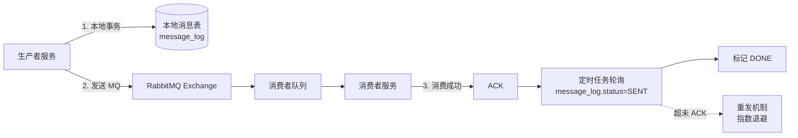

# Kubo 平台高并发重构实施路线规划计划

> **文档版本**：v1.2  
> **适用项目**：Kubo 智能生产管理系统 (原 SPMS)  
> **目标规模**：10,000+ 并发用户、7×24 小时生产环境、多工厂多租户  
> **核心技术栈**：Spring Cloud Alibaba (Nacos/Dubbo 3) + **MyBatis-Plus + 分页插件** + **RabbitMQ** + **MySQL 8.0 (InnoDB Cluster) + Redis Cluster** + Kubernetes + GitOps  
> **服务命名规范**：`kubo-{domain}` (如 `kubo-wms`, `kubo-mes`, `kubo-auth`)

---

## 1. 技术栈确认与选型定论

### 1.1 消息队列选型结论：✅ **确认使用 RabbitMQ**

| 维度 | RocketMQ | **RabbitMQ (最终选型)** | 决策理由 |
|------|----------|------------------------|----------|
| **事务消息** | 原生支持 | **需基于「本地消息表 + 定时补偿」实现** | 团队对 RabbitMQ 运维经验丰富，实现成本可控 |
| **顺序消息** | 原生支持 (FIFO) | **单队列 + 单消费者 + Sharding Key 路由** | 库存扣减等关键场景可通过分片队列保证顺序 |
| **延时消息** | 原生支持 | **死信队列 (DLX) + TTL 实现** | 成熟方案，运维无负担 |
| **吞吐量** | 百万级/秒 | **十万级/秒 (集群模式)** | 10k 用户场景下，RabbitMQ 集群完全满足 |
| **运维成本** | 专用 NameServer/Broker | **Erlang 集群，团队熟悉** | **降低认知负荷，复用现有监控/告警体系** |
| **生态集成** | Spring Cloud Stream 原生 | **Spring AMQP / Spring Cloud Stream RabbitMQ Binder 完美支持** | 代码迁移成本极低 |

> **实施策略**：
> - **核心强一致链路** (订单-库存-财务)：**Seata AT 模式 + 本地消息表 + RabbitMQ 可靠性投递**
> - **高并发异步解耦** (日志、通知、报表、物联)：**RabbitMQ 标准交换机/队列模型 + 消费端幂等**
> - **顺序消费场景** (库存扣减、工单流转)：**一致性哈希分片队列 + 单消费者实例**
> - **延时/定时任务** (预警升级、订单超时关闭)：**DLX + TTL 死信队列模式**

### 1.2 完整技术栈版本表

| 领域 | 选型 | 版本/规格 | 备注 |
|------|------|-----------|------|
| **主数据库** | **MySQL** | **8.0 (InnoDB Cluster / Group Replication)** | **暂定主力 OLTP 底座**，成熟稳定、团队熟悉、生态完善；配合 ShardingSphere 实现读写分离、分库分表；InnoDB Cluster 提供原生高可用 (RPO=0, RTO<30s) |
| **ORM 框架** | **MyBatis-Plus** | 3.5.x | 替换 JPA/Hibernate，支持复杂 SQL、分页插件、乐观锁、自动填充 |
| **分页插件** | **MyBatis-Plus Pagination Inner Interceptor** | 内置 | 物理分页，支持 MySQL/PostgreSQL/Oracle，配合 ShardingSphere 透明分页 |
| **消息队列** | **RabbitMQ** | 3.12+ (集群模式 Quorum Queues) | 事务消息靠本地消息表，顺序消费靠分片队列，延时靠 DLX |
| **服务框架** | Spring Cloud Alibaba (Nacos 2.x + Dubbo 3.x) | Dubbo 3.2+ (Triple 协议) | 注册配置中心、RPC、服务治理 |
| **分库分表** | **ShardingSphere-JDBC** | 5.4+ | 读写分离、分片算法、影子库压测 |
| **缓存** | **Redis Cluster** (6M/6S) + Redisson + Caffeine | 7.x | 多级缓存、分布式锁、限流 |
| **分布式事务** | **Seata AT 模式** (兼容 TCC) | 2.0+ | 跨服务强一致 (订单-库存-财务) |
| **API 网关** | **Spring Cloud Gateway** / **Apache APISIX** | 3.x / 3.x | 统一鉴权、限流、熔断、灰度 |
| **部署运维** | Kubernetes (K8s) + Helm + ArgoCD + GitOps | 1.28+ | 多可用区、弹性伸缩、滚动发布、自愈 |
| **可观测** | Prometheus + Grafana + SkyWalking + ELK/Loki | 最新稳定版 | 三支柱全覆盖 |

> **数据库选型说明**：
> - **MySQL 8.0** 作为**核心交易型业务 (OLTP) 的主力数据库**，支撑订单、库存、财务、工单等强一致性场景。
> - **InnoDB Cluster (3主多从)** 提供原生高可用、自动故障切换、多源复制，**RPO=0、RTO<30s**，满足金融级可靠性要求。
> - **后续演进预留**：报表/分析型查询 (OLAP) 迁移至 **ClickHouse / Doris**；物联网时序数据写入 **TDengine / IoTDB**；全文检索接入 **Elasticsearch**；冷数据归档至 **OSS/HDFS + Hive/Iceberg**。**核心 OLTP 长期锚定 MySQL**，避免分布式数据库 (TiDB/OceanBase/PolarDB-X) 引入的运维复杂度与兼容性风险，除非单表突破 5 亿行或写入 QPS 突破 5 万+ 才评估分布式数据库切换。

---

## 2. 微服务命名与代码仓库规范

### 2.1 服务命名映射表

| 业务域 | 旧名称 | **新名称** | 代码仓库 | 数据库 Schema |
|--------|--------|------------|----------|---------------|
| 网关 | - | **kubo-gateway** | kubo-gateway | - |
| 认证授权 | spms-auth | **kubo-auth** | kubo-auth | kubo_auth |
| 系统管理 | spms-system | **kubo-system** | kubo-system | kubo_system |
| 人事/组织 | spms-personnel | **kubo-personnel** | kubo-personnel | kubo_personnel |
| 仓储管理 | spms-wms | **kubo-wms** | kubo-wms | kubo_wms |
| 制造执行 | spms-mes | **kubo-mes** | kubo-mes | kubo_mes |
| 工厂建模 | spms-factory | **kubo-factory** | kubo-factory | kubo_factory |
| 资产设备 | spms-asset | **kubo-asset** | kubo-asset | kubo_asset |
| 采购管理 | spms-procurement | **kubo-procurement** | kubo-procurement | kubo_procurement |
| 销售管理 | spms-sales | **kubo-sales** | kubo-sales | kubo_sales |
| 财务核算 | spms-finance | **kubo-finance** | kubo-finance | kubo_finance |
| 物联网关 | spms-iot | **kubo-iot** | kubo-iot | kubo_iot (时序库 TDengine) |
| 报表分析 | spms-report | **kubo-report** | kubo-report | kubo_report (ES/ClickHouse) |
| 通知中心 | spms-notify | **kubo-notify** | kubo-notify | kubo_notify |
| 文件存储 | spms-file | **kubo-file** | kubo-file | kubo_file (MinIO 元数据) |
| 公共基础库 | spms-common | **kubo-common** | kubo-common | - |

### 2.2 Maven 坐标规范
```xml
<groupId>cn.kubo</groupId>
<artifactId>kubo-{domain}</artifactId>
<version>1.0.0-SNAPSHOT</version>
```
**父工程**：`kubo-parent` (依赖管理、插件配置、统一版本锁定)

### 2.3 包名规范
```java
// 基础包
cn.kubo.{domain}

// 示例
cn.kubo.wms.controller
cn.kubo.wms.service
cn.kubo.wms.mapper
cn.kubo.wms.entity
cn.kubo.wms.dto
cn.kubo.wms.event
```

---

## 3. RabbitMQ 关键模式落地设计 (替代 RocketMQ 原生能力)

### 3.1 可靠性投递模式 (替代事务消息)


**本地消息表结构**：
```sql
CREATE TABLE message_log (
    id BIGINT PRIMARY KEY,
    message_key VARCHAR(128) NOT NULL UNIQUE,  -- 幂等键
    exchange VARCHAR(128) NOT NULL,
    routing_key VARCHAR(128) NOT NULL,
    payload JSON NOT NULL,
    status ENUM('INIT','SENT','DONE','FAILED') DEFAULT 'INIT',
    retry_count INT DEFAULT 0,
    next_retry_time DATETIME,
    created_at DATETIME DEFAULT CURRENT_TIMESTAMP,
    updated_at DATETIME DEFAULT CURRENT_TIMESTAMP ON UPDATE CURRENT_TIMESTAMP,
    INDEX idx_status_retry (status, next_retry_time)
);
```

### 3.2 顺序消费模式 (库存扣减、工单流转)
```yaml
# 队列拓扑：按 warehouse_id / work_order_id 一致性哈希分片
# 16 个分片队列，每个队列绑定单独消费者实例
spring:
  rabbitmq:
    listener:
      simple:
        concurrency: 16  # 与分片数一致
        prefetch: 100
```
```java
// 生产者：路由键 = shardKey % 16
rabbitTemplate.convertAndSend("kubo.wms.stock.deduct", "shard." + (warehouseId % 16), msg);

// 消费者：@RabbitListener(queues = "kubo.wms.stock.deduct.shard.#{T(java.lang.Integer).parseInt(#{@shardIndex})}")
// 同一 warehouseId 始终路由到同一分片 → 同一消费者实例 → 顺序消费
```

### 3.3 延时消息模式 (订单超时、预警升级)
```java
// 1. 定义延时交换机 + 死信交换机
@Configuration
class RabbitDelayConfig {
    @Bean
    Exchange delayExchange() { return ExchangeBuilder.topicExchange("kubo.delay.exchange").durable(true).build(); }
    
    @Bean
    Exchange deadLetterExchange() { return ExchangeBuilder.topicExchange("kubo.dlx.exchange").durable(true).build(); }
    
    @Bean
    Queue orderTimeoutQueue() {
        return QueueBuilder.durable("kubo.order.timeout.queue")
            .withArgument("x-dead-letter-exchange", "kubo.dlx.exchange")
            .withArgument("x-dead-letter-routing-key", "order.timeout.execute")
            .build();
    }
    
    @Bean
    Binding delayBinding() {
        return BindingBuilder.bind(orderTimeoutQueue()).to(delayExchange()).with("order.timeout.#").noargs();
    }
}

// 2. 发送延时消息 (TTL = 延时时长)
rabbitTemplate.convertAndSend("kubo.delay.exchange", "order.timeout." + orderNo, 
    msg, m -> { m.getMessageProperties().setExpiration(String.valueOf(delayMs)); return m; });

// 3. 消费者监听死信队列执行真正逻辑
@RabbitListener(queues = "kubo.order.timeout.execute.queue")
public void handleOrderTimeout(OrderTimeoutMsg msg) { ... }
```

---

## 4. 分阶段详细实施路线图 (总周期 16 周)

### 阶段 0：基建与规范落地 (第 1-2 周) —— **「跑通一条线」**

| 步骤 | 任务 | 产出物 | 验收标准 |
|------|------|--------|----------|
| 0.1 | **K8s 集群搭建** (3 AZ、Ingress、Cert-Manager、监控命名空间) | `kubo-infra/k8s-cluster` | `kubectl get nodes` Ready，三 AZ 节点就绪 |
| 0.2 | **中间件集群部署** (Nacos、RabbitMQ 集群、Redis Cluster、**MySQL InnoDB Cluster**、Seata Server) | `kubo-infra/middleware` (Helm Charts) | 所有组件健康检查通过，支持跨 AZ 容灾 |
| 0.3 | **CI/CD 流水线构建** (GitLab CI / Jenkins + ArgoCD + SonarQube + Trivy) | `.gitlab-ci.yml` / `Jenkinsfile` + ArgoCD ApplicationSet | 提交代码自动构建、扫描、部署到 Dev 环境 |
| 0.4 | **父工程 & 公共库发布** (`kubo-parent`, `kubo-common`) | Maven Central / 私服 | 依赖版本锁定、通用切面(幂等/锁/限流/脱敏)、BaseMapper、DTO 规范发布 |
| 0.5 | **RabbitMQ 基础设施代码落地** | `kubo-common-mq` 模块 | **核心产出**：`ReliableMessageSender` (本地消息表+重试)、`ShardedOrderlyListener` (分片顺序消费)、`DelayMessageSender` (DLX延时)、`IdempotentConsumer` (幂等消费抽象) |
| 0.6 | **规范文档定稿** | `DEVELOPMENT_GUIDE.md`, `DATABASE_STANDARD.md`, `API_DESIGN_GUIDE.md`, `GIT_COMMIT_SPEC.md`, `RABBITMQ_USAGE_GUIDE.md` | 团队评审通过，Code Review 纳入强制检查项 |
| 0.7 | **「钢丝」链路验证** | `kubo-gateway` + `kubo-auth` + `kubo-wms` (仅库存扣减) | **全链路跑通**：登录 → 鉴权 → 网关路由 → 库存扣减 (Seata AT) → RabbitMQ 可靠投递 → 财务记账 → 响应 < 200ms |

> **里程碑 M0**：**第 2 周末**，「钢丝」链路在 Dev 环境稳定运行，压测单接口 1000 QPS 无熔断。

---

### 阶段 1：核心域微服务化重构 (第 3-8 周) —— **「攻坚主战场」**

#### 1.1 kubo-wms (仓储核心) - 优先级 P0
| 步骤 | 任务 | 关键技术点 | 产出 |
|------|------|------------|------|
| 1.1.1 | **数据库拆分 & 分片规则定义** | ShardingSphere: `inventory_flow` 按 `warehouse_id + 月` 分表；`stock_qty` 按 `warehouse_id` 分片 | `sharding-wms.yaml` + Flyway 脚本 |
| 1.1.2 | **实体/Mapper/Service 迁移** | MyBatis-Plus: `BaseMapper`、乐观锁 `@Version`、自动填充 `MetaObjectHandler` | 单元测试覆盖率 > 90% |
| 1.1.3 | **核心写链路事务化** | Seata AT: `入库单/出库单/盘点单` 全局事务 + 本地事务 | 分布式事务回滚演练通过 |
| 1.1.4 | **库存扣减高并发模式** | **乐观锁 + Redis 预扣减 + Lua 脚本原子校验 + RabbitMQ 分片顺序队列异步落库** | 单 SKU 扣减 5000 QPS，超卖率 = 0 |
| 1.1.5 | **查询链路读写分离 & 缓存** | ShardingSphere 读写分离 + Caffeine (热库存) + Redis Cluster (库存可用量) | P99 < 50ms，缓存命中率 > 95% |
| 1.1.6 | **对外事件发布** | `InventoryChangedEvent` (库存变动)、`StockAlertEvent` (预警) → RabbitMQ Topic `kubo.wms.inventory` | 下游消费端验收通过 |

#### 1.2 kubo-mes (制造执行) - 优先级 P0
| 步骤 | 任务 | 关键技术点 | 产出 |
|------|------|------------|------|
| 1.2.1 | **工单/工序/排程模型拆分** | 聚合根设计：`WorkOrder` (聚合根) → `WorkOrderOperation` → `WorkOrderMaterial` | DDD 领域模型代码 |
| 1.2.2 | **排程引擎隔离** | 独立 `kubo-mes-scheduler` 模块 (可选单独部署)，OptaPlanner / 自研启发式算法 | 排程耗时 < 5s (万工单级) |
| 1.2.3 | **工单执行状态机** | 状态模式 + 事件溯源 (可选) + 幂等保障 | 状态流转图 + 审计日志 |
| 1.2.4 | **物联数据对接** | 消费 `kubo.iot.device.telemetry` → 实时工单进度/质量采集 | 数据延迟 < 1s |
| 1.2.5 | **工单成本结转** | RabbitMQ 可靠投递 → `kubo-finance` 生成成本凭证 | 跨域强一致 |

#### 1.3 kubo-factory (工厂建模) - 优先级 P1
| 步骤 | 任务 | 产出 |
|------|------|------|
| 1.3.1 | **主数据服务化** | 车间/产线/工位/设备/BOM/工艺路线 CRUD + 树形查询 (CTE/Closure Table) |
| 1.3.2 | **主数据变更事件** | 发布 `FactoryMasterDataChangedEvent` → 通知 WMS/MES/Asset 刷新本地缓存 |

#### 1.4 kubo-finance (财务核算) - 优先级 P0 (强一致核心)
| 步骤 | 任务 | 关键技术点 |
|------|------|------------|
| 1.4.1 | **凭证/科目/期间/成本核算模型** | 复式记账、期间锁账、并发凭证号生成 (Redis Segment 模式) |
| 1.4.2 | **成本核算引擎** | 消费 `InventoryChangedEvent` / `WorkOrderCompletedEvent` → 标准成本/实际成本/差异分析 |
| 1.4.3 | **财务审计链路** | 全字段变更审计 (AOP + `kubo-audit-log-starter`)、不可篡改存证 |

#### 1.5 kubo-auth (统一认证授权 & 权限引擎) - 优先级 P0 (全平台基石)
| 步骤 | 任务 | 核心产出 |
|------|------|----------|
| 1.5.1 | **OAuth 2.1 / OIDC 认证服务** | Authorization Code + PKCE、Refresh Token 轮换、JWT Access Token (短时效) |
| 1.5.2 | **行级/列级权限引擎** | **核心交付**：`DataPermissionInterceptor` (MyBatis-Plus 拦截器注入 WHERE) + `ColumnMaskingAspect` (AOP 脱敏) + Redis 规则缓存 + RabbitMQ 规则刷新 |
| 1.5.3 | **权限管理后台** | 角色-实体-谓词配置 UI、字段脱敏策略配置、租户隔离配置 |
| 1.5.4 | **网关集成** | `kubo-gateway` 集成 `kubo-auth` 实现统一鉴权、Token 透传、权限上下文注入 |

> **里程碑 M1**：**第 8 周末**，核心四域 (`wms`, `mes`, `factory`, `finance`) + `auth` + `gateway` 在 **Staging 环境** 全链路联调通过，**全链路压测达标 (核心写链路 3000 QPS, P99 < 150ms, 0 错误)**。

---

### 阶段 2：支撑与协作域微服务化 (第 6-11 周) —— **「并行推进」**

| 服务 | 关键任务 | 依赖/集成点 | 预计完成周 |
|------|----------|-------------|------------|
| **kubo-procurement** | 采购订单、到货单、供应商对账、入库单回传 WMS | `kubo-wms` (入库事件)、`kubo-finance` (应付单) | 第 9 周 |
| **kubo-sales** | 销售报价、订单、发货单(扣减库存)、开票、回款 | `kubo-wms` (出库事件)、`kubo-finance` (应收/收入) | 第 10 周 |
| **kubo-asset** | 设备台账、点检计划/执行、维修工单、备件领用/采购 | `kubo-factory` (设备主数据)、`kubo-wms` (备件库存)、`kubo-mes` (设备状态) | 第 10 周 |
| **kubo-personnel** | 员工档案、组织架构、考勤、薪资(敏感字段脱敏)、绩效 | `kubo-auth` (组织同步)、`kubo-system` (字典) | 第 9 周 |
| **kubo-system** | 租户管理、字典、参数配置、操作审计日志查询 | 所有服务依赖 (启动加载字典缓存) | 第 7 周 |
| **kubo-iot** | 协议解析 (Modbus/OPC UA/MQTT)、设备影子、规则引擎、时序数据写入 TDengine | `kubo-mes` (遥测数据)、`kubo-asset` (设备状态) | 第 11 周 |
| **kubo-report** | 多维数据集、看板配置、定时导出、异步大文件下载 | ES/ClickHouse 实时同步 (Flink CDC) | 第 11 周 |
| **kubo-notify** | 多渠道模板、发送记录、重试策略、WebSocket 推送 | 所有服务异步调用 | 第 8 周 |
| **kubo-file** | MinIO 对接、预览/水印/病毒扫描、临时签名下载 | 所有服务上传/下载 | 第 8 周 |

> **里程碑 M2**：**第 11 周末**，全域服务在 Staging 环境部署完成，**端到端业务流程 (采购→入库→生产→销售→发货→回款→财务结账) 自动化测试用例 100% 通过**。

---

### 阶段 3：平台化能力与生产就绪 (第 10-14 周) —— **「打磨成产品」**

| 专题 | 任务清单 | 交付标准 |
|------|----------|----------|
| **3.1 多租户 & 数据隔离** | ShardingSphere 租户分片算法 (`tenant_id`)、`kubo-auth` 租户上下文传递、网关租户路由 | 单实例支撑 100+ 租户，数据绝对隔离 |
| **3.2 配置中心 & 功能开关** | Nacos 配置分组/命名空间、灰度发布规则、动态刷新 (不重启) | 业务开关毫秒级生效 |
| **3.3 分布式任务调度** | XXL-Job / PowerJob 集成：定时结账、MRP 运算、报表预计算、数据归档 | 任务高可用、分片广播、日志可追溯 |
| **3.4 数据归档 & 冷热分离** | ShardingSphere Shadow Table / 定时任务：历史流水迁移至 ClickHouse/归档库 | 主库单表 < 5000 万，查询性能稳定 |
| **3.5 安全合规加固** | 数据库加密 (字段级)、传输加密 (mTLS)、审计日志不可篡改、渗透测试报告 | 等保三级合规、通过第三方渗透测试 |
| **3.6 混沌工程演练** | Chaos Mesh / Litmus: Pod Kill、网络分区、CPU 压满、DB 主备切、MQ Broker 宕机 | 核心链路 RTO < 5min, RPO = 0，熔断降级生效验证 |
| **3.7 全链路压测 & 容量规划** | Gatling 全场景脚本 (核心 10 个业务流程)、梯度加压至 1.5 倍预估峰值 | 生成《性能测试报告》、《容量规划书》、扩容触发阈值配置 |
| **3.8 文档 & 运维手册** | 架构决策记录 (ADR)、API 文档 (OpenAPI 3.0)、部署运维手册、应急预案 (SOP)、开发者上手指南 | 新人 1 天上手，运维 0 文档依赖处理告警 |

> **里程碑 M3**：**第 14 周末**，**生产环境预发布版本就绪**，所有非功能性指标达标，混沌演练通过，文档归档完整。

---

### 阶段 4：灰度发布与全量上线 (第 13-16 周) —— **「平稳落地」**

| 周次 | 策略 | 关键动作 | 回滚条件 |
|------|------|----------|----------|
| **第 13 周** | **内网验收 (UAT)** | 邀请关键用户(仓管/调度/财务)在 Staging 实操核心流程，收集 Bug 修复 | P0 Bug > 0 不得进入下一阶段 |
| **第 14 周** | **单工厂灰度 (Canary 5%)** | ArgoCD Rollout: `kubo-gateway` 权重路由 5% 流量至新版，旧版保留 95% | 错误率 > 0.1% / P99 > 300ms / 核心业务投诉 > 3 单 → 秒级回滚 |
| **第 15 周** | **扩大灰度 (20% → 50% → 100%)** | 每日扩容一档，白天观察、夜间扩容，核心指标看板盯盘 | 同回滚条件 |
| **第 16 周** | **全量切换 & 旧系统下线** | DNS/Ingress 切流 100%，旧系统进入**只读归档期 (3 个月)**，数据核对脚本跑批 | 数据核对不一致 > 0 条 → 立即冻结切换 |

> **里程碑 M4 (项目交付)**：**第 16 周末**，新平台全量承接生产流量，**连续运行 14 天 无 P0 事故**，性能指标持续达标。

---

## 5. 关键技术攻关专项 (贯穿全周期)

| 专项 | 负责角色 | 关键交付物 | 完成时间点 |
|------|----------|------------|------------|
| **权限引擎内核** | 架构师 + 资深后端 | `kubo-auth-permission-starter` (MyBatis-Plus 拦截器 + AOP 脱敏 + 缓存刷新) | **第 3 周末** (阻塞所有域开发) |
| **分布式事务框架** | 架构师 + 核心后端 | Seata AT 模式最佳实践文档 + `kubo-seata-starter` (自动代理数据源、全局锁模板) | **第 4 周末** |
| **高并发库存扣减** | WMS 域专家 | `InventoryDeductService` (Redis 预扣 + Lua + RabbitMQ 分片顺序队列 + 最终一致性补偿) | **第 5 周末** |
| **分库分表中间件** | DBA + 架构师 | ShardingSphere 规则配置库 + 迁移工具 (Dual Write + 校验脚本) | **第 6 周末** |
| **RabbitMQ 基础设施库** | 架构师 + 核心后端 | `kubo-common-mq` (可靠投递/分片顺序/延时/幂等消费四大模式封装) | **第 2 周末** (M0 阻塞项) |
| **物联网数据管道** | IoT 域专家 | `kubo-iot` 接入协议适配器 + TDengine 建模 + Flink CDC 同步 ES | **第 10 周末** |
| **报表实时计算** | 报表域专家 | Flink SQL 作业库 (宽表构建、物化视图维护) | **第 11 周末** |

---

## 6. 风险预案与应对策略 (ROAM 模型)

| 风险 | 等级 | 应对策略 (Mitigate) | 触发条件 | 应急预案 (Contingency) |
|------|------|---------------------|----------|------------------------|
| **ShardingSphere 分片迁移数据不一致** | 🔴 高 | 1. 双写模式跑 2 周<br>2. 全量/增量校验脚本自动化<br>3. 影子表压测验证 | 校验脚本发现不一致 > 0 | **立即切回单库模式**，启用只读归档库，人工核对修复后重新迁移 |
| **Seata AT 模式长事务锁死** | 🔴 高 | 1. 业务拆解缩短本地事务<br>2. 全局锁超时配置 30s<br>3. 关键路径改 TCC | 死锁监控告警 > 5 次/小时 | **紧急切换该业务为 TCC 模式**，或引入本地消息表 + 定时补偿 |
| **RabbitMQ 消息堆积导致磁盘告警** | 🟠 中 | 1. Quorum Queues 存储上限配置<br>2. 消费端并行度动态扩容 (HPA)<br>3. 堆积阈值告警 (10万/队列)<br>4. 死信队列隔离 | 堆积 > 50万 / 消费延迟 > 10min | **启动独立消费实例组** 专消堆积，主消费组恢复正常；紧急扩容磁盘 |
| **分片顺序消费单点热点** | 🟠 中 | 1. 预分片 16/32 个队列<br>2. 热点 Key (大仓) 独立队列 + 独立消费组<br>3. 监控分片负载均衡 | 单分片 QPS > 总 QPS * 30% | **紧急拆分热点分片**，增加消费者实例 |
| **MyBatis-Plus 复杂查询性能劣化** | 🟠 中 | 1. 严禁 `SELECT *`<br>2. 强制 `EXPLAIN` 评审<br>3. 慢 SQL 自动推送钉钉 | P99 > 500ms / 扫描行数 > 10万 | **紧急上线物化视图 / ES 宽索引**，下线慢查询接口 |
| **权限引擎规则缓存击穿** | 🟠 中 | 1. Caffeine 本地缓存兜底<br>2. 互斥锁重建<br>3. 规则版本号机制 | Redis 命中率 < 90% | **降级走 DB 直查**，同时触发缓存预热任务 |
| **核心人员流失/知识断层** | 🟡 中 | 1. ADR 文档强制落地<br>2. 结对编程 / Code Review 知识共享<br>3. 关键模块视频录制 | 关键模块仅 1 人熟悉 | **启动外包/内部借调**，按 ADR 文档快速接管 |
| **上线后发现重大数据 Bug** | 🔴 高 | 1. 灰度期每日全量数据核对<br>2. 关键表 `binlog` 订阅实时校验<br>3. 回滚演练月度化 | 灰度期发现金额/库存不平 | **秒级流量切回旧系统**，启动数据修复脚本，根因分析后再发布 |

---

## 7. 资源投入与团队组织建议

| 角色 | 人数 | 职责 | 关键产出 |
|------|------|------|----------|
| **技术总监/架构师** | 1 | 整体架构决策、技术攻关把关、跨域协调、Code Review 终审 | 架构决策记录 (ADR)、核心框架代码 |
| **资深后端工程师** | 4-5 | 核心域 (WMS/MES/Finance/Auth) 开发、性能调优、疑难杂症 | 高质量微服务代码、单测/集成测试 |
| **中高级后端工程师** | 4-6 | 支撑域 (Procurement/Sales/Asset/Personnel/IoT/Report) 开发 | 标准化微服务代码 |
| **DBA** | 1-2 | 数据库架构设计、分片规则制定、SQL 审核、迁移脚本、性能调优 | `sharding.yaml`、Flyway 脚本、慢 SQL 优化报告 |
| **DevOps/SRE** | 2 | K8s 集群运维、CI/CD 建设、监控告警体系、混沌工程、安全合规 | 自动化部署流水线、Grafana 大盘、SOP 文档 |
| **测试/QA** | 2 | 自动化测试框架、集成测试用例、性能测试脚本、混沌实验执行 | 测试报告、缺陷趋势分析 |
| **产品经理/业务分析师** | 1-2 | 需求梳理、验收标准定义、UAT 组织、数据核对规则 | 业务流程图、验收用例、数据核对脚本 |

---

## 8. 成功交付标准 (Definition of Done)

| 维度 | 指标 | 验收方式 |
|------|------|----------|
| **功能完整性** | 覆盖旧系统 100% 核心用例 + 新增权限/多租户/物联/报表能力 | UAT 签字、自动化回归通过率 100% |
| **性能达标** | 核心写链路 3000 QPS / P99 < 200ms / 错误率 < 0.01% | Gatling 全链路压测报告 |
| **高可用性** | 单节点故障 < 30s 自愈 / AZ 级故障 < 5min 切换 / RPO = 0 | 混沌工程演练报告 |
| **数据一致性** | 核心财务/库存流水 T+1 全量核对 0 差异 / 实时流水校验 0 告警 | 数据核对脚本日志 |
| **安全合规** | 等保三级测评通过 / 渗透测试 0 高危 / 敏感字段 100% 脱敏 | 第三方测评报告 |
| **可维护性** | 单元测试覆盖率 > 80% / 核心域 > 95% / 文档覆盖 100% / 新人上手 < 1 天 | SonarQube 质量门禁、新人 Onboarding 记录 |
| **运维就绪** | 所有告警有 SOP / 部署全自动化 / 变更审批流程化 / 灰度发布标准化 | 运维手册审核、模拟故障演练 |

---

## 9. 附录：核心代码仓库结构预览

```text
kubo-platform/ (Monorepo 推荐，或多仓库)
├── kubo-parent/                 # 父工程、依赖管理、插件配置
├── kubo-common/                 # 公共基础库
│   ├── kubo-common-core/        # 通用 DTO、异常、工具、注解、BaseEntity
│   ├── kubo-common-security/    # JWT、权限上下文、注解 (@RequirePermission)
│   ├── kubo-common-resilience/  # 幂等、分布式锁、限流、熔断切面
│   ├── kubo-common-dao/         # MyBatis-Plus 配置、BaseMapper、分页、乐观锁、自动填充
│   ├── kubo-common-seata/       # Seata AT 自动代理、全局锁模板
│   ├── kubo-common-mq/          # **RabbitMQ 封装：可靠投递/分片顺序/延时/幂等消费**
│   ├── kubo-common-audit/       # 审计日志 AOP、变更捕获、异步落库
│   └── kubo-common-permission/  # 行级/列级权限引擎 Starter (核心内核)
├── kubo-gateway/                # API 网关
├── kubo-auth/                   # 认证授权中心 (含权限管理后台)
├── kubo-system/                 # 系统管理
├── kubo-wms/                    # 仓储核心
├── kubo-mes/                    # 制造执行
├── kubo-factory/                # 工厂建模
├── kubo-finance/                # 财务核算
├── kubo-procurement/            # 采购管理
├── kubo-sales/                  # 销售管理
├── kubo-asset/                  # 资产设备
├── kubo-personnel/              # 人事组织
├── kubo-iot/                    # 物联网关
├── kubo-report/                 # 报表分析
├── kubo-notify/                 # 通知中心
├── kubo-file/                   # 文件存储
├── kubo-infra/                  # 基础设施即代码
│   ├── k8s/                     # Helm Charts、Kustomize
│   ├── middleware/              # 中间件部署脚本
│   └── monitoring/              # Grafana Dashboard、Prometheus Rules、SkyWalking 告警
├── kubo-perf-tests/             # Gatling/JMeter 压测脚本
├── kubo-docs/                   # 架构决策记录(ADR)、API 文档、运维手册
└── docker-compose.yml           # 本地开发环境一键启动
```

---

**文档状态**：**已定稿，可执行**  
**核心决策**：✅ **MyBatis-Plus + 分页插件** ✅ **RabbitMQ (集群模式 + 本地消息表补偿事务 + 分片顺序 + DLX延时)** ✅ **MySQL 8.0 InnoDB Cluster (主力 OLTP) + Redis Cluster (多级缓存)** ✅ **kubo-{domain} 命名**  
**下一步行动**：**第 1 周启动会** → 分配任务 → 搭建 `kubo-infra` 基建 → 发布 `kubo-parent` & `kubo-common` 快照版 → **第 2 周末跑通「钢丝」链路 (含 RabbitMQ 可靠投递模式验证)**。