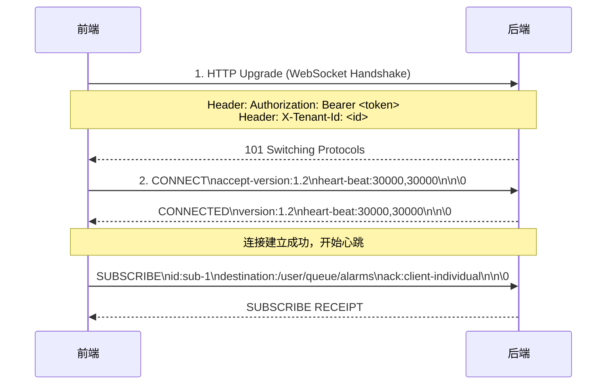
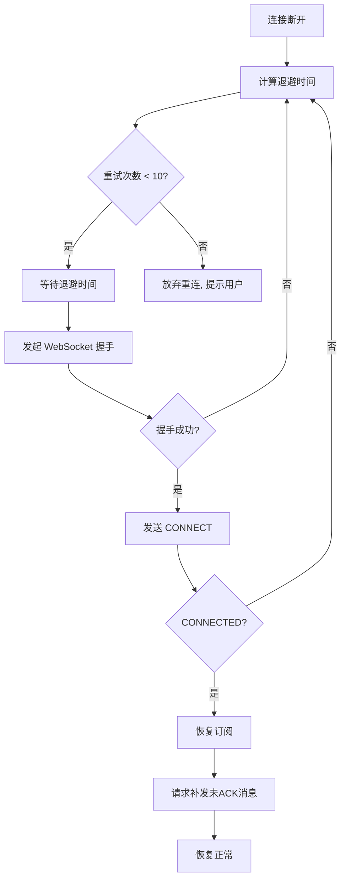

# Kubo 平台 WebSocket 协议规范文档

> ⚠️ **文档勘误（2026-09-10）：本文正文描述的「STOMP over WebSocket」选型与实际代码实现背离，从未落地。**
> 代码实际采用 airpower **原生 WebSocket + 自定义 JSON**（非 STOMP），协议事实以代码为准，见下方「§0 实际实现」。
> 本文 STOMP 专属章节（CONNECT/SUBSCRIBE/ACK 帧、目标地址、STOMP 速查表）仅作**历史设计参考**，
> 不要再据此实现 STOMP 客户端；与协议无关的通用机制（心跳、指数退避重连、安全考量、监控指标）仍适用。

> **版本**：v1.0
> **状态**：⚠️ 选型章节与实现背离（历史设计稿），实际协议见 §0
> **适用范围**：全平台实时通信 (设备遥测、报警推送、工单流转、协作通知)
> **实际协议**：**原生 WebSocket + 自定义 JSON**（airpower `WebSocketHandler` / `AppWebSocketHandler`）

---

## 0. 实际实现（代码为准）

| 项 | 实际实现 |
|----|----------|
| 端点 | `ws(s)://<host>/websocket?accessToken=<token>`（token 走查询参数：浏览器原生 WebSocket 不支持自定义请求头） |
| 认证 | 后端 `afterConnectionEstablished` 读 `session.getUri().getQuery()` → `AccessTokenUtil.verify(query, secret)`，取出 `payloadId`（即 userId） |
| 心跳 | 客户端发文本帧 `PING`，后端 `handleTextMessage` 命中 `getPing()`（默认 `PING`）后回 `PONG` |
| 业务消息 | 文本帧为 `WebSocketPayload` 的 JSON `{ type, data }`，后端 `Json.parse` 后交 `onWebSocketPayload(payload, session)` |
| 频道订阅 | 后端 `subscribe(channel, session)` / `unsubscribe(channel, session)`；客户端发 `{ type: 'subscribe'\|'unsubscribe', data: channel }` |
| 前端实现 | `src/websocket/WebSocketManager.ts`（心跳 + 指数退避重连 + 0–30% 抖动，最多 10 次） |
| 后端实现 | `cn.hamm.spms.common.AppWebSocketHandler`（extends airpower `cn.hamm.airpower.websocket.WebSocketHandler`） |

---

## 1. 协议选型决策 (ADR-005) —— ⚠️ 历史设计，未按此落地

| 备选方案 | 评估 | 决策 |
|----------|------|------|
| **原生 WebSocket + 自定义 JSON** | 灵活、airpower 原生支持；前端 `WebSocketManager` 已实现心跳/重连，无需 STOMP | ✅ **实际实现** |
| **STOMP over WebSocket** | 标准化、生态成熟、Spring 原生支持 | ❌ 未落地（本文正文历史设计） |
| Socket.io | 自动重连/房间/降级，但非标准、需 Node 服务端 | ❌ 技术栈不匹配 |
| gRPC Streaming | 强类型、高性能，但浏览器需 gRPC-Web 代理 | ❌ 复杂度高 |
| Server-Sent Events (SSE) | 单向、简单、自动重连 | ⚠️ 仅作补单/导出进度等单向场景补充 |

---

## 2. 连接建立流程



### 2.1 握手阶段

| 步骤 | 说明 | 关键点 |
|------|------|--------|
| 1. HTTP Upgrade | 标准 WebSocket 握手 | 必须携带 `Authorization: Bearer <access_token>` 和 `X-Tenant-Id` |
| 2. STOMP CONNECT | 协议协商 | `accept-version:1.2`、`heart-beat:30000,30000` (客户端发送/接收间隔 ms) |
| 3. STOMP CONNECTED | 服务端确认 | 返回 `heart-beat:30000,30000`、`version:1.2`、`server:Kubo/1.0` |

### 2.2 认证失败处理

| 场景 | 服务端响应 | 前端处理 |
|------|------------|----------|
| Token 过期/无效 | `ERROR\nmessage:Authentication failed\ncontent-type:text/plain\n\nToken expired\0` | 关闭连接，触发 Token 刷新流程，刷新成功后重连 |
| 租户不存在 | `ERROR\nmessage:Tenant not found\0` | 提示用户联系管理员 |
| 并发连接超限 | `ERROR\nmessage:Max connections exceeded\0` | 提示用户在其他设备登录，踢掉旧连接 |

---

## 3. 心跳与保活机制

### 3.1 心跳配置

| 参数 | 值 | 说明 |
|------|-----|------|
| **客户端发送间隔** | 30,000 ms (30s) | 客户端每 30s 发送一个心跳帧 |
| **服务端发送间隔** | 30,000 ms (30s) | 服务端每 30s 发送一个心跳帧 |
| **容忍缺失次数** | 2 次 | 连续 2 个心跳间隔未收到帧，判定连接断开 |
| **心跳帧格式** | 单个字节 `\n` (0x0A) | STOMP 规范心跳帧 |

### 3.2 心跳帧示例

```
# 客户端 -> 服务端 (每 30s)
\n

# 服务端 -> 客户端 (每 30s)
\n
```

### 3.3 心跳超时处理

| 角色 | 检测逻辑 | 动作 |
|------|----------|------|
| **客户端** | 60s 内未收到任何帧 (含心跳) | 发起重连流程 (指数退避) |
| **服务端** | 60s 内未收到任何帧 | 关闭连接，清理订阅资源，发布 `SessionDisconnectedEvent` |

---

## 4. 订阅与消息模型

### 4.1 目标地址设计规范

| 场景 | 目标地址格式 | 说明 |
|------|--------------|------|
| **用户私有队列** | `/user/queue/{topic}` | 点对点，仅特定用户接收 (如报警、待办) |
| **用户广播主题** | `/user/topic/{topic}` | 用户级广播 (如多标签页同步) |
| **租户广播主题** | `/tenant/{tenantId}/topic/{topic}` | 租户级广播 (如公告、系统维护通知) |
| **业务实体主题** | `/topic/{entity}/{action}` | 实体级事件 (如 `/topic/inventory/changed`) |
| **设备遥测流** | `/topic/device/{deviceId}/telemetry` | 设备实时数据流 |

### 4.2 订阅/取消订阅帧

```stomp
# 订阅 (客户端 -> 服务端)
SUBSCRIBE
id:sub-001
destination:/user/queue/alarms
ack:client-individual
selector:priority >= 5

\n\0

# 订阅确认 (服务端 -> 客户端)
RECEIPT
receipt-id:sub-001

\n\0

# 取消订阅
UNSUBSCRIBE
id:sub-001

\n\0
```

### 4.3 消息帧格式

```stomp
# 服务端 -> 客户端 (消息推送)
MESSAGE
subscription:sub-001
destination:/user/queue/alarms
message-id:msg-20260801-001
timestamp:1722489600000
priority:HIGH
content-type:application/json
content-length:256

{
  "alarmId": 12345,
  "deviceId": "DEV-001",
  "alarmType": "TEMPERATURE_HIGH",
  "level": "CRITICAL",
  "message": "设备温度超过阈值: 95°C",
  "timestamp": "2026-08-01T12:00:00Z",
  "ackRequired": true
}
\0
```

### 4.4 消息头标准字段

| 字段名 | 必填 | 说明 | 示例 |
|--------|------|------|------|
| `destination` | ✅ | 目标地址 | `/user/queue/alarms` |
| `subscription` | ✅ | 订阅 ID | `sub-001` |
| `message-id` | ✅ | 全局唯一消息 ID | `msg-20260801-001` |
| `timestamp` | ✅ | 服务端生成时间戳 (ms) | `1722489600000` |
| `priority` | ⭕ | 优先级: `LOW`/`NORMAL`/`HIGH`/`CRITICAL` | `HIGH` |
| `content-type` | ✅ | 消息体格式 | `application/json` |
| `ack-required` | ⭕ | 是否需要手动 ACK | `true` |
| `priority` | ⭕ | 优先级 (用于客户端队列排序) | `10` (数值越大越高) |
| `retry-count` | ⭕ | 重试次数 (重发时递增) | `0` |

---

## 5. 确认机制 (ACK/NACK)

### 5.1 确认模式

| 模式 | 适用场景 | 前端行为 |
|------|----------|----------|
| `auto` | 低优先级、可丢失通知 | 客户端收到即自动确认 |
| `client` | 重要业务、需保证处理 | 客户端处理完成后手动发送 ACK |
| `client-individual` | **推荐默认** (逐条确认) | 逐条处理、逐条 ACK/NACK |

### 5.2 ACK/NACK 帧格式

```stomp
# 确认 (客户端 -> 服务端)
ACK
subscription:sub-001
message-id:msg-20260801-001

\n\0

# 拒绝/重新入队 (客户端 -> 服务端)
NACK
subscription:sub-001
message-id:msg-20260801-001

\n\0
```

### 5.3 服务端重发策略

| 场景 | 重发策略 |
|------|----------|
| 客户端 NACK | 立即重发，`retry-count + 1` |
| 客户端处理超时 (30s 未 ACK) | 重发，`retry-count + 1`，最多 3 次 |
| 客户端断开连接 | 连接恢复后，按 `message-id` 补发未 ACK 消息 |
| 超过最大重试次数 (3次) | 进入死信队列 (DLQ)，记录告警，人工处理 |

---

## 6. 重连与断点续传

### 6.1 重连触发条件

| 条件 | 说明 |
|------|------|
| WebSocket 连接断开 (网络波动、服务端重启) | |
| 心跳超时 (60s 无帧) | |
| 服务端主动关闭 (发送 `ERROR` 帧后关闭) | |
| 客户端主动关闭后重新打开页面 | |

### 6.2 重连流程



### 6.3 退避策略 (指数退避 + 抖动)

```typescript
// 前端实现参考
function calculateBackoff(attempt: number): number {
  const baseDelay = 1000 // 1s
  const maxDelay = 30000 // 30s
  const delay = Math.min(baseDelay * 1.5 ** attempt, maxDelay)
  const jitter = Math.random() * 0.3 * delay // 0-30% 抖动
  return Math.floor(delay + jitter)
}

// 尝试次数与延迟对照
// 第1次: ~1-1.3s
// 第2次: ~2.2-2.9s
// 第3次: ~3.4-4.4s
// 第4次: ~5-6.5s
// 第5次: ~7.5-9.8s
// 第6次: ~11-14.6s
// 第7次: ~16-21s
// 第8次: ~24-30s (封顶)
```

### 6.4 断点续传 - 补发未 ACK 消息

```stomp
# 客户端重连成功后，请求补发
SEND
destination:/system/ws/resend
content-type:application/json

{
  "lastAckedMessageId": "msg-20260801-001",
  "subscriptions": [
    {"id": "sub-001", "destination": "/user/queue/alarms"},
    {"id": "sub-002", "destination": "/topic/inventory/changed"}
  ]
}
\n\0
```

```stomp
# 服务端响应补发
MESSAGE
subscription:sub-001
destination:/user/queue/alarms
message-id:msg-20260801-002
timestamp:1722489605000
retry-count:0
x-resend:true
content-type:application/json

{ "alarmId": 12346, ... }
\0
```

---

## 7. 消息优先级与背压控制

### 7.1 优先级定义

| 级别 | 值 | 适用场景 | 处理优先级 |
|------|-----|----------|------------|
| `CRITICAL` | 100 | 紧急报警、安全事件、停机指令 | 最高，插队处理 |
| `HIGH` | 75 | 重要报警、工单状态变更、审批通知 | 高 |
| `NORMAL` | 50 | 普通通知、状态同步、进度更新 | 正常 |
| `LOW` | 25 | 日志推送、统计更新、心跳 | 低，可批量/延迟 |

### 7.2 客户端优先级队列实现

```typescript
// 优先级队列实现
class PriorityMessageQueue {
  private queues: Map<Priority, Message[]> = new Map([
    [Priority.CRITICAL, []],
    [Priority.HIGH, []],
    [Priority.NORMAL, []],
    [Priority.LOW, []],
  ])

  private processing = false
  private maxConcurrent = 3 // 并发处理上限

  enqueue(message: StompMessage) {
    const priority = this.parsePriority(message.headers)
    this.queues.get(priority)!.push(message)
    this.scheduleProcess()
  }

  private async process() {
    if (this.processing)
      return
    this.processing = true

    while (this.hasMessages()) {
      const msg = this.dequeueHighestPriority()
      await this.processMessage(msg)
      // 背压控制：每帧处理不超过 16ms
      if (performance.now() - frameStart > 16) {
        await nextFrame()
      }
    }
    this.processing = false
  }
}
```

### 7.3 背压控制策略

| 策略 | 触发条件 | 动作 |
|------|----------|------|
| **客户端队列积压** | 待处理消息 > 100 条 | 暂停接收新消息 (发送 `PAUSE` 控制帧)，处理完毕后恢复 |
| **处理耗时过长** | 单帧处理 > 16ms | 让出主线程 (`await nextFrame()`) |
| **内存压力** | JS Heap > 100MB | 丢弃 `LOW` 优先级消息，触发 GC |

---

## 8. 消息类型定义 (TypeScript)

```typescript
// 通用消息头
interface StompHeaders {
  'destination': string
  'subscription'?: string
  'message-id': string
  'timestamp': string
  'priority'?: 'CRITICAL' | 'HIGH' | 'NORMAL' | 'LOW'
  'content-type': 'application/json'
  'ack-required'?: 'true' | 'false'
  'retry-count'?: string
  'x-resend'?: 'true'
  [key: string]: string
}

// 基础消息结构
interface StompFrame<T = unknown> {
  command: 'CONNECT' | 'CONNECTED' | 'SUBSCRIBE' | 'UNSUBSCRIBE'
    | 'SEND' | 'MESSAGE' | 'ACK' | 'NACK' | 'ERROR' | 'RECEIPT'
  headers: StompHeaders
  body?: T
}

// 业务消息基类
interface BaseMessage<T = unknown> {
  messageId: string
  timestamp: string
  type: string
  payload: T
}

// 报警消息
interface AlarmMessage extends BaseMessage<AlarmPayload> {
  type: 'ALARM'
  payload: {
    alarmId: number
    deviceId: string
    alarmType: string
    level: 'INFO' | 'WARNING' | 'CRITICAL'
    message: string
    timestamp: string
  }
}

// 工单状态变更
interface WorkOrderMessage extends BaseMessage<WorkOrderPayload> {
  type: 'WORK_ORDER_STATUS_CHANGED'
  payload: {
    workOrderId: number
    oldStatus: string
    newStatus: string
    operatorId: number
  }
}

// 库存变动
interface InventoryMessage extends BaseMessage<InventoryPayload> {
  type: 'INVENTORY_CHANGED'
  payload: {
    warehouseId: number
    materialId: number
    quantityChange: number
    currentQuantity: number
  }
}

// 联合类型
type BusinessMessage = AlarmMessage | WorkOrderMessage | InventoryMessage
```

---

## 9. 错误码定义 (WebSocket 专用)

| 错误码 | HTTP 状态 | 含义 | 客户端处理 |
|--------|-----------|------|------------|
| `WS_AUTH_FAILED` | 401 | 认证失败 | 刷新 Token 重连 |
| `WS_TENANT_NOT_FOUND` | 404 | 租户不存在 | 提示联系管理员 |
| `WS_MAX_CONNECTIONS` | 429 | 并发连接超限 | 提示踢掉其他设备 |
| `WS_SUBSCRIBE_FAILED` | 403 | 订阅权限不足 | 提示无权限 |
| `WS_RATE_LIMITED` | 429 | 消息发送过快 | 客户端限流 |
| `WS_MESSAGE_TOO_LARGE` | 413 | 消息体过大 | 压缩/分片 |
| `WS_SERVER_ERROR` | 500 | 服务端内部错误 | 重连重试 |
| `WS_UNSUPPORTED_VERSION` | 400 | STOMP 版本不支持 | 升级客户端 |

---

## 10. 监控指标定义

### 10.1 关键指标

| 指标名 | 类型 | 采集频率 | 告警阈值 |
|--------|------|----------|----------|
| `ws_connections_active` | Gauge | 10s | > 预期峰值 * 1.5 |
| `ws_messages_received_total` | Counter | 1m | - |
| `ws_messages_sent_total` | Counter | 1m | - |
| `ws_message_latency_ms` | Histogram | 1m | P99 > 500ms |
| `ws_reconnect_total` | Counter | 1m | > 100/min |
| `ws_heartbeat_timeout_total` | Counter | 1m | > 10/min |
| `ws_message_queue_size` | Gauge | 10s | > 1000 |
| `ws_ack_latency_ms` | Histogram | 1m | P99 > 5s |

### 10.2 告警规则示例 (PrometheusRule)

```yaml
- alert: WebSocketHighConnectionCount
  expr: ws_connections_active > 15000
  for: 5m
  labels:
    severity: warning
  annotations:
    summary: WebSocket 连接数过高

- alert: WebSocketHighReconnectRate
  expr: rate(ws_reconnect_total[5m]) > 20
  for: 2m
  labels:
    severity: critical
  annotations:
    summary: WebSocket 重连率异常高

- alert: WebSocketMessageLatencyHigh
  expr: histogram_quantile(0.99, rate(ws_message_latency_ms_bucket[5m])) > 500
  for: 3m
  labels:
    severity: warning
  annotations:
    summary: WebSocket 消息延迟过高
```

---

## 11. 安全考量

| 安全点 | 实施方案 |
|--------|----------|
| **传输加密** | 生产环境强制 `wss://` (TLS 1.2+) |
| **认证授权** | 握手阶段验证 JWT + 租户 ID，订阅时二次校验权限 |
| **消息校验** | 消息体 JSON Schema 校验，拒绝非法字段 |
| **速率限制** | 连接级/用户级/租户级多维限流 (Token Bucket) |
| **消息加密** | 敏感业务消息字段级加密 (AES-GCM) |
| **审计日志** | 连接/订阅/消息发送/ACK 全链路审计 (脱敏) |
| **防重放** | 消息 ID 幂等校验 + 时间戳窗口 (5min) |

---

## 12. 版本兼容性策略

| 版本 | 兼容性 | 迁移策略 |
|------|--------|----------|
| **v1.0** | 基线版本 | - |
| **v1.1** | 向后兼容 | 新增可选字段，旧客户端忽略 |
| **v2.0** | 不兼容 | 新增 `/v2/` 命名空间，双版本并行 3 个月 |

---

## 13. 测试用例清单

| 测试类别 | 用例 | 预期结果 |
|----------|------|----------|
| **连接建立** | 正常 Token 连接 | CONNECTED |
| | 过期 Token | ERROR + 重连触发刷新 |
| | 无效 Token | ERROR + 断开 |
| | 并发连接超限 | ERROR + 提示 |
| **心跳** | 正常心跳 | 双向心跳帧 |
| | 客户端心跳停止 | 服务端 60s 后断开 |
| | 服务端心跳停止 | 客户端 60s 后重连 |
| **订阅/取消** | 订阅私有队列 | 收到 MESSAGE |
| | 订阅无权限主题 | RECEIPT + ERROR |
| | 取消订阅 | 不再收到消息 |
| **ACK/NACK** | 正常 ACK | 服务端标记已处理 |
| | NACK 重发 | 收到重发消息 |
| | 超时未 ACK | 自动重发 |
| **重连** | 网络断开恢复 | 自动重连 + 补发 |
| | 服务端重启 | 客户端自动重连 |
| | 重连超限 | 放弃 + 提示用户 |
| **优先级** | CRITICAL 插队 | 优先处理 |
| | 积压背压 | 暂停接收/丢弃 LOW |
| **安全** | 消息篡改 | 校验失败拒绝 |
| | 速率超限 | 429 限流 |
| | 重放攻击 | 幂等校验拒绝 |

---

## 14. 附录：STOMP 帧速查表

| 命令 | 方向 | 必需头 | 说明 |
|------|------|--------|------|
| `CONNECT` | C→S | `accept-version`, `heart-beat` | 客户端发起连接 |
| `CONNECTED` | S→C | `version`, `heart-beat` | 服务端确认连接 |
| `SUBSCRIBE` | C→S | `id`, `destination`, `ack` | 客户端订阅 |
| `UNSUBSCRIBE` | C→S | `id` | 客户端取消订阅 |
| `SEND` | C→S | `destination` | 客户端发送消息 |
| `MESSAGE` | S→C | `subscription`, `destination`, `message-id` | 服务端推送消息 |
| `ACK` | C→S | `subscription`, `message-id` | 客户端确认 |
| `NACK` | C→S | `subscription`, `message-id` | 客户端拒绝 |
| `ERROR` | S→C | `message` | 服务端错误 |
| `RECEIPT` | S→C | `receipt-id` | 服务端确认收到客户端帧 |
| `DISCONNECT` | C→S | - | 客户端主动断开 |

---

**文档状态**：🟢 **已定稿，强制执行**
**维护者**：前端架构师 + 后端架构师
**变更流程**：任何修改需通过架构评审，更新版本号，通知全栈团队
