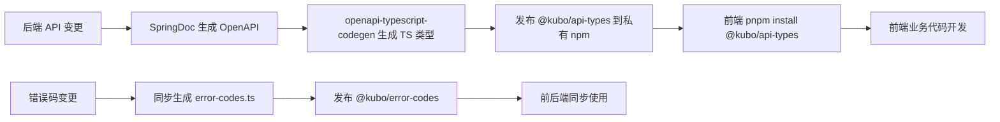

# ADR-006: 代码仓库管理策略 - Monorepo (pnpm) vs 多仓库

> **状态**：✅ 已通过  
> **日期**：2026-08-01  
> **决策者**：前端架构师 + 后端架构师  
> **技术栈影响**：工程化、CI/CD、代码管理  
> **关联文档**：[前端仓库结构规划](../Kubo 平台-前端高并发重构实施路线规划计划.md#10-附录前端代码仓库结构规划-重构后)

---

## 1. 背景与问题

### 问题描述
- 前后端代码仓库管理策略未统一
- 共享代码（类型定义、工具函数、配置）在多仓库间同步困难
- CI/CD 流水线配置重复、维护成本高
- 代码复用率低、版本同步痛点多

### 约束条件
- 前端团队熟悉 pnpm workspace
- 后端使用 Maven 多模块
- 需要支持独立部署、独立版本发布
- 团队规模 10-15 人，代码审查流程已建立

### 驱动因素
- 共享代码复用需求 (API 类型、工具函数、UI 组件、配置)
- CI/CD 统一化、标准化需求
- 原子提交、跨仓库重构需求

---

## 2. 备选方案

### 方案 A: 前端 Monorepo (pnpm workspace) + 后端 Maven 多模块 + 共享包发布 ✅ **选中**

| 维度 | 评价 |
|------|------|
| **优点** | - **前后端技术栈各自最优**：前端 pnpm workspace、后端 Maven 多模块，各取所长<br>- **前端 Monorepo 优势**：共享包原子更新、统一 lint/tsconfig/vite 配置、依赖去重、统一 CI/CD<br>- **后端 Maven 多模块**：成熟稳定、IDE 支持最好、发布管理成熟<br>- **共享包发布机制**：前端生成的 API 类型包、共享 UI 组件库发布到私有 npm registry，后端通过 Maven 依赖管理<br>- **独立部署**：各服务/应用独立构建、独立版本、独立部署<br>- **团队自治**：前端团队管前端 Monorepo，后端团队管后端 Maven 工程 |
| **缺点** | - 跨语言共享包需发布流程 (npm registry + Maven repo)<br>- 版本同步需发布流程 (API 类型变更需重新生成并发布)<br>- 两套 CI/CD 体系维护成本 |
| **技术成熟度** | 高 |
| **团队熟悉度** | 高 (前端 pnpm、后端 Maven) |
| **运维复杂度** | 中 |
| **扩展性** | 强 |

### 方案 B: 完全 Monorepo (前后端同仓)

| 维度 | 评价 |
|------|------|
| **优点** | - 单仓库管理、原子提交<br>- 共享代码零发布延迟<br>- 统一 CI/CD、统一版本号 |
| **缺点** | - **技术栈冲突**：前端 pnpm/node、后端 Maven/Java，构建工具链完全不同<br>- **构建极慢**：单次构建需同时编译 Java/TypeScript、跑所有测试<br>- **团队冲突**：前后端提交互相干扰、代码审查混乱<br>- **部署耦合**：前端改动触发后端构建、反之亦然<br>- **工具链割裂**：IDE、Lint、测试、构建工具链完全割裂 |
| **技术成熟度** | 低 (跨语言 Monorepo 实践少) |
| **团队熟悉度** | 低 |
| **运维复杂度** | 高 |
| **扩展性** | 弱 |

### 方案 C: 多仓库 (每个微服务/应用一仓库)

| 维度 | 评价 |
|------|------|
| **优点** | - 服务完全隔离、独立演进<br>- 团队完全自治、权限隔离<br>- 故障域隔离 |
| **缺点** | - **共享代码同步噩梦**：API 类型、UI 组件、工具函数、配置在 15+ 仓库同步<br>- **版本依赖地狱**：Diamond 依赖、版本冲突频发<br>- **CI/CD 重复配置**：15+ 套流水线维护成本极高<br>- **跨仓库重构极难**：API 变更需同时改 10+ 仓库<br>- **代码复用率极低** |
| **技术成熟度** | 高 |
| **团队熟悉度** | 高 |
| **运维复杂度** | 高 (维护成本极高) |
| **扩展性** | 弱 (治理成本随服务数线性增长) |

---

## 3. 决策结果

**最终选择**：**方案 A - 前端 Monorepo (pnpm workspace) + 后端 Maven 多模块 + 共享包发布**

### 仓库结构设计

```
# 组织级仓库结构
kubo-platform/                    # 组织级 Git 组织
├── kubo-platform/                # 后端主仓库 (Maven 多模块)
│   ├── kubo-parent/
│   ├── kubo-common/
│   ├── kubo-gateway/
│   ├── kubo-auth/
│   ├── kubo-wms/
│   ├── ...
│   └── kubo-infra/
│
├── kubo-web/                     # 前端主仓库 (pnpm workspace Monorepo)
│   ├── apps/
│   │   ├── kubo-web-main/
│   │   ├── kubo-web-admin/
│   │   └── kubo-web-mobile/
│   ├── packages/
│   │   ├── kubo-web-request/
│   │   ├── kubo-web-query/
│   │   ├── kubo-web-ws/
│   │   ├── kubo-web-permission/
│   │   ├── kubo-web-components/
│   │   ├── kubo-web-monitor/
│   │   ├── kubo-web-utils/
│   │   └── kubo-web-config/
│   ├── tools/
│   ├── .github/workflows/
│   ├── pnpm-workspace.yaml
│   ├── package.json
│   └── tsconfig.base.json
│
├── kubo-shared/                  # 共享包仓库 (发布到私有 Registry)
│   ├── kubo-api-types/           # OpenAPI 生成的 TS 类型包 (@kubo/api-types)
│   ├── kubo-api-client/          # 通用 API 客户端 (@kubo/api-client)
│   ├── kubo-shared-utils/        # 共享工具函数 (@kubo/shared-utils)
│   ├── kubo-error-codes/         # 错误码枚举同步包 (@kubo/error-codes)
│   └── kubo-design-tokens/       # 设计 Token (@kubo/design-tokens)
│
└── kubo-infra/                   # 基础设施即代码仓库
    ├── k8s/
    ├── middleware/
    ├── monitoring/
    └── scripts/
```

### 共享包发布流程



### 共享包版本策略

| 包名 | 版本策略 | 发布触发 |
|------|----------|----------|
| `@kubo/api-types` | 与后端 API 版本强绑定 (v1.0.0-api.v1.2.0) | 后端 API 发布时自动生成发布 |
| `@kubo/error-codes` | 与后端 ErrorCode 版本强绑定 | 后端 ErrorCode 变更时自动发布 |
| `@kubo/api-client` | 语义化版本 | 手动发布 / 依赖升级时 |
| `@kubo/shared-utils` | 语义化版本 | 功能新增/修复时 |
| `@kubo/design-tokens` | 语义化版本 | 设计系统变更时 |

---

## 3. 仓库治理规范

### 分支策略

| 仓库类型 | 主分支 | 开发分支 | 发布分支 | 热修复分支 |
|----------|--------|----------|----------|------------|
| 后端 Maven | `main` | `develop` | `release/v*` | `hotfix/v*` |
| 前端 Monorepo | `main` | `develop` | `release/v*` | `hotfix/v*` |
| 共享包 | `main` | - | `release/v*` | `hotfix/v*` |

### 提交规范 (Conventional Commits)

```
<type>(<scope>): <subject>

<body>

<footer>
```

| 类型 | 说明 | 示例 |
|------|------|------|
| `feat` | 新功能 | `feat(wms): 添加库存预扣减接口` |
| `fix` | 修复缺陷 | `fix(auth): 修复 Token 刷新并发问题` |
| `refactor` | 重构 | `refactor(common): 重构请求网关拦截器` |
| `perf` | 性能优化 | `perf(wms): 优化库存扣减 Lua 脚本` |
| `docs` | 文档更新 | `docs(api): 更新 WebSocket 协议文档` |
| `style` | 代码格式 | `style: 统一缩进为 2 空格` |
| `test` | 测试相关 | `test(wms): 增加库存扣减单测` |
| `chore` | 构建/工具/依赖 | `chore(deps): 升级 Spring Boot 到 3.2.5` |
| `ci` | CI/CD 配置 | `ci: 添加性能回归测试门禁` |
| `revert` | 回滚 | `revert: 撤销 feat(wms): 新增预扣减` |

### 代码审查规范

| 规则 | 要求 |
|------|------|
| **MR 必须关联 Issue** | MR 标题/描述必须包含 `Closes #ISSUE_ID` |
| **最少审查人数** | 核心域 ≥ 2 人、非核心 ≥ 1 人 |
| **自动化门禁** | 单测覆盖率 > 80%、构建通过、Lint 通过、类型检查通过、包体积 < 阈值 |
| **性能门禁** | Lighthouse CI 分数不回归、包体积不超标 |
| **安全门禁** | 依赖漏洞扫描 0 high/critical、敏感信息扫描通过 |

---

## 4. CI/CD 流水线设计

### 后端流水线

```yaml
# .gitlab-ci.yml / Jenkinsfile 关键阶段
stages:
  - validate          # 代码规范、依赖检查
  - test              # 单测、集成测试、契约测试
  - build             # 编译、打包、镜像构建
  - security          # 漏洞扫描、依赖审计、敏感信息扫描
  - deploy-dev        # 部署到 Dev 环境
  - test-e2e          # 端到端测试
  - deploy-staging    # 部署到 Staging 环境
  - performance       # 性能压测 (仅 release 分支)
  - deploy-prod       # 部署到生产 (手动确认)
```

### 前端流水线

```yaml
stages:
  - validate          # Lint、类型检查、依赖审计
  - test              # 单测、组件测试
  - build             # 构建、包体积分析、性能基线对比
  - test-e2e          # Playwright E2E、视觉回归
  - deploy-dev        # 部署到 Dev CDN
  - test-e2e-staging  # Staging 环境 E2E
  - deploy-staging    # 部署到 Staging CDN
  - performance       # Lighthouse CI 性能回归
  - deploy-prod       # 生产发布 (CDN 刷新、SW 版本更新)
```

### 共享包发布流水线

```yaml
# 仅 main/release 分支触发
stages:
  - validate
  - test
  - version-bump      # 语义化版本自动递增 (基于 conventional commits)
  - publish           # 发布到私有 npm registry / Maven Central
  - notify            # 通知下游仓库更新依赖
```

---

## 4. 实施计划

| 阶段 | 任务 | 负责人 | 截止日期 | 验收标准 |
|------|------|--------|----------|----------|
| 1 | 后端 Maven 多模块结构搭建 | 后端架构 | 第 1 周三 | `kubo-parent` 发布、核心模块编译通过 |
| 2 | 前端 pnpm Monorepo 脚手架搭建 | 前端架构 | 第 1 周五 | `kubo-web` 可跑通、共享包结构就绪 |
| 3 | 私有 npm Registry 搭建 | DevOps | 第 1 周五 | Verdaccio/Nexus 可用、认证配置 |
| 3 | 共享包发布流水线 | DevOps | 第 2 周三 | `@kubo/api-types` 可发布安装 |
| 4 | API 类型自动生成流水线 | DevOps + 前端 | 第 2 周五 | 后端变更 → 自动生成 → 发布 → 前端安装 |
| 5 | 统一 CI/CD 模板 | DevOps | 第 2 周五 | 所有服务/应用复用模板 |

---

## 4. 影响评估

| 影响维度 | 影响程度 | 影响说明 | 缓解措施 |
|----------|----------|----------|----------|
| 现有代码迁移 | 中 | 现有代码迁移到新结构 | 分批迁移、灰度验证 |
| 开发流程变更 | 中 | 适应 Monorepo 开发模式 | 文档培训、Pair Programming |
| CI/CD 迁移 | 中 | 现有流水线迁移到新模板 | 复用模板、统一维护 |
| 共享包版本管理 | 低 | 新增发布流程 | 自动化发布流水线 |
| 团队协作 | 正向 | 代码复用率提升、冲突减少 | 建立规范文档 |

---

## 5. 相关链接

- [pnpm Workspace 官方文档](https://pnpm.io/workspaces)
- [Maven 多模块最佳实践](https://maven.apache.org/guides/mini/guide-multiple-modules.html)
- [Conventional Commits 规范](https://www.conventionalcommits.org/zh-hans/v1.0.0/)
- [Semantic Versioning](https://semver.org/lang/zh-CN/)
- [GitLab CI/CD 官方文档](https://docs.gitlab.com/ee/ci/)
- 后续 ADR: [ADR-007: 监控告警体系选型](ADR-007-监控告警体系.md)

---

*ADR 版本：v1.0*  
*最后更新：2026-08-01*