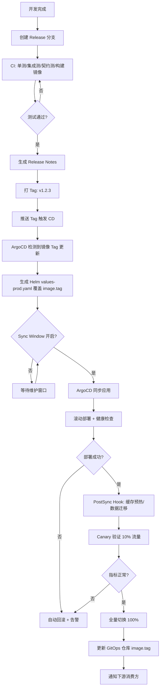

# ADR-008: 部署发布策略 - GitOps + ArgoCD + 蓝绿/金丝雀发布

> **状态**：✅ 已通过
> **日期**：2026-08-01
> **决策者**：DevOps + 架构师
> **技术栈影响**：部署发布、CI/CD、运维体系
> **关联文档**：[部署架构](../Kubo 平台高并发重构实施路线规划计划.md#4-分阶段详细实施路线图-总周期-16-周)

---

## 1. 背景与问题

### 问题描述
- 微服务架构需要标准化、自动化、可回滚的部署发布体系
- 原系统手动部署、无灰度能力、回滚困难
- 需要支撑 16 个微服务的并行开发、独立部署、版本管理

### 约束条件
- 团队对 Kubernetes、Helm、ArgoCD 有基础经验
- 预算有限，倾向开源 GitOps 方案
- 需要支持多环境、灰度发布、蓝绿部署、一键回滚
- 需要满足合规审计要求（变更记录、审批流程）

### 驱动因素
- 微服务数量多（16+），手动部署不可行
- 灰度发布、金丝雀发布是生产稳定性保障
- GitOps 实现声明式部署、配置即代码、审计追溯

---

## 2. 备选方案

### 方案 A: GitOps + ArgoCD + Helm + Kustomize ✅ **选中**

| 维度 | 评价 |
|------|------|
| **优点** | - **声明式部署**：Git 为单一事实来源，声明式期望状态<br>- **自动同步**：ArgoCD 持续监控 Git 仓库，自动同步到集群<br>- **可视化/审计**：UI 可见应用状态、同步历史、差异对比<br>- **渐进式交付**：原生支持蓝绿、金丝雀、滚动、金丝雀分析<br>- **RBAC 权限控制**：项目级/环境级权限隔离<br>- **自动修正/回滚**：漂移检测、自动修正、一键回滚<br>- **Helm + Kustomize 双支持**：模板渲染 + 覆盖叠加，灵活适配多环境 |
| **缺点** | - 学习曲线中等（ArgoCD 概念、ApplicationSet、Sync Windows）<br>- ArgoCD 自身高可用需额外部署（HA 模式）<br>- Secret 管理需外部方案 或 SealedSecrets<br>- 大规模应用同步性能需调优 |
| **技术成熟度** | 高 (CNCF 毕业项目) |
| **团队熟悉度** | 中 |
| **运维复杂度** | 中 |
| **成本** | 低 (开源) |
| **扩展性** | 强 |

### 方案 B: Jenkins + Helm + 手动脚本

| 维度 | 评价 |
|------|------|
| **优点** | - 团队熟悉 Jenkins、Groovy 脚本<br>- 灵活度高、逻辑可编程<br>- 插件生态极丰富 |
| **缺点** | - **非声明式**：流水线即代码，状态不在 Git，难以审计<br>- **无原生 GitOps**：无法实现声明式持续同步<br>- **手动介入多**：回滚、扩容、配置变更需手动触发<br>- **维护成本高**：Groovy 脚本维护成本高、插件兼容性问题<br>- **无原生渐进式交付**：金丝雀/蓝绿需自己写逻辑 |
| **技术成熟度** | 高 |
| **团队熟悉度** | 高 |
| **运维复杂度** | 高 (脚本维护) |
| **成本** | 低 |

### 方案 C: GitLab CI/CD + Kubernetes 原生部署

| 维度 | 评价 |
|------|------|
| **优点** | - GitLab 原生集成、零额外组件<br>- Auto DevOps 零配置启动<br>- 内置容器镜像仓库、制品库<br>- 环境管理、部署板、回滚按钮 |
| **缺点** | - **GitLab 耦合度高**：CI/CD 与代码托管强绑定<br>- **渐进式交付弱**：无原生金丝雀分析、自动回滚<br>- **多集群管理弱**：不如 ArgoCD 多集群管理原生<br>- **审计/合规**：变更记录分散在 Pipeline 日志中<br>- **大规模微服务**：Pipeline 维护成本随服务数线性增长 |
| **技术成熟度** | 高 |
| **团队熟悉度** | 中 |
| **运维复杂度** | 中 |
| **成本** | 中 (GitLab Ultimate 许可证) |

### 方案 D: Flux CD + Helm (纯 GitOps)

| 维度 | 评价 |
|------|------|
| **优点** | - CNCF 毕业、纯 GitOps、CNCF 毕业<br>- 更轻量、无 UI 依赖、纯控制器模式<br>- Kustomize 原生支持、HelmRelease CRD<br>- 多租户、多集群原生支持 |
| **缺点** | - **无 UI**：无可视化界面、调试困难<br>- **学习曲线陡峭**：Flux 概念、Kustomize、HelmRelease CRD<br>- **无原生渐进式交付**：需配合 Flagger 实现金丝雀<br>- **团队零经验**：学习成本高 |
| **技术成熟度** | 高 |
| **团队熟悉度** | 低 |
| **运维复杂度** | 中 |
| **成本** | 低 |

---

## 3. 决策结果

**最终选择**：方案 A - **GitOps + ArgoCD + Helm + Kustomize**

### 选择理由
1. **声明式 GitOps** - 符合云原生最佳实践，Git 为单一事实来源
2. **渐进式交付原生支持** - 蓝绿、金丝雀、滚动、分析原生支持
3. **可视化运维** - UI 直观展示应用状态、同步状态、资源树
4. **审计合规** - 所有变更在 Git 留痕，ArgoCD 记录同步历史
5. **生态成熟** - CNCF 毕业、社区活跃、企业级生产就绪
4. **多环境管理** - ApplicationSet 矩阵生成、环境隔离

### 妥协与风险
- ArgoCD 自身 HA 部署复杂度 → 部署 3 副本 HA 模式，配置 Redis HA
- Secret 管理 → 采用 SealedSecrets + 外部 Vault
- 大规模同步性能 → 调整 `syncWave`、分批同步、资源配额

**缓解措施**：
- 建立标准化 Helm Chart 模板库 (`kubo-helm-charts`)
- 统一 ApplicationSet 模板，矩阵生成多环境应用
- 建立统一的 `SyncWindow` 维护窗口策略
- 配置 `PreSync`/`PostSync` Hook 实现数据库迁移、缓存预热

---

## 3. 部署架构设计

### 3.1 环境拓扑

```
┌─────────────────────────────────────────────────────────────────┐
                        GitOps 仓库
    ┌─────────────────────────────────────────────────────────┐
    │  kubo-platform/ (GitOps 仓库)                           │
    │  ├── apps/                    # ArgoCD Application 定义 │
    │   │   ├── kubo-wms.yaml       # 应用定义 + 目标环境      │
    │   │   ├── kubo-mes.yaml       │
    │   │   ├── ...                 │
    │   ├── clusters/               # 集群配置                │
    │   │   ├── dev/                │
    │   │   ├── staging/            │
    │   │   ├── prod/               │
    │   ├── projects/               # ArgoCD Project 定义     │
    │   └── applicationsets/        # ApplicationSet 矩阵     │
    └─────────────────────────────────────────────────────────┘
                              │
                              ▼
    ┌─────────────────────────────────────────────────────────┐
                    ArgoCD (控制平面)
    ┌─────────────────────────────────────────────────────────┐
    │  - Application Controller (同步控制器)                   │
    │  - Repo Server (Git 仓库同步)                            │
    │  - Dex/OIDC (认证)                                       │
    │  - Redis HA (缓存/锁)                                    │
    └─────────────────────────────────────────────────────────┘
                              │
              ┌───────────────┼───────────────┐
              ▼               ▼               ▼
        ┌──────────┐    ┌──────────┐    ┌──────────┐
        │  Dev     │    │ Staging  │    │  Prod    │
        │ Cluster  │    │ Cluster  │    │ Cluster  │
        │ (1 AZ)   │    │ (2 AZ)   │    │ (3 AZ)   │
        └──────────┘    └──────────┘    └──────────┘
```

### 3.2 环境策略

| 环境 | 集群 | 命名空间策略 | 同步策略 | 审批流程 |
|------|------|--------------|----------|----------|
| **Dev** | 单 AZ | `kubo-dev-*` | 自动同步 (`AutoSync=true`) | 无 (推送即部署) |
| **Staging** | 2 AZ | `kubo-staging-*` | 手动同步 (`AutoSync=false`) | MR 合并后手动同步 |
| **Prod** | 3 AZ | `kubo-prod-*` | 手动同步 + **Sync Window** | 变更单审批 + 维护窗口同步 |

---

## 3.3 部署策略矩阵

| 服务类型 | 部署策略 | 滚动配置 | 健康检查 | 回滚策略 |
|----------|----------|----------|----------|----------|
| **无状态微服务** | RollingUpdate | `maxSurge=25%`, `maxUnavailable=0` | Liveness/Readiness/Startup | 立即回滚 (`kubectl rollout undo`) |
| **有状态服务** | RollingUpdate (有序) | `maxSurge=0`, `maxUnavailable=1` | StatefulSet 健康检查 | 按序回滚 |
| **数据库迁移** | Job + InitContainer | `backoffLimit=3` | InitContainer 成功 | 手动回滚 + Flyway undo |
| **前端静态资源** | Recreate + CDN 刷新 | - | CDN 缓存刷新验证 | CDN 版本回滚 |

---

## 3.4 Helm Chart 标准结构

```
kubo-helm-charts/
├── kubo-microservice/          # 通用微服务 Chart
│   ├── Chart.yaml
│   ├── values.yaml             # 默认值
│   ├── values-dev.yaml         # Dev 环境覆盖
│   ├── values-staging.yaml     # Staging 覆盖
│   ├── values-prod.yaml        # Prod 覆盖
│   ├── templates/
│   │   ├── deployment.yaml     # Deployment + HPA
│   │   ├── service.yaml        # Service + Headless
│   │   ├── ingress.yaml        # Ingress + TLS
│   │   ├── configmap.yaml      # ConfigMap
│   │   ├── secret.yaml         # Secret (SealedSecret)
│   │   ├── servicemonitor.yaml # Prometheus 监控
│   │   ├── pdb.yaml            # PodDisruptionBudget
│   │   ├── networkpolicy.yaml  # NetworkPolicy
│   │   ├── hpa.yaml            # HorizontalPodAutoscaler
│   │   └── _helpers.tpl        # 模板函数
│   └── values.schema.json      # 值校验
├── kubo-stateful/              # 有状态服务 Chart
├── kubo-infra/                 # 基础设施 Chart
└── kubo-frontend/              # 前端 Chart
```

### 3.5 核心 Values 规范

```yaml
# values.yaml 核心字段规范
replicaCount: 3
image:
  repository: harbor.kubo.example.com/kubo/kubo-wms
  tag: "v1.2.3"
  pullPolicy: IfNotPresent
  pullSecrets: [harbor-secret]

resources:
  limits:
    cpu: "2000m"
    memory: "4Gi"
  requests:
    cpu: "1000m"
    memory: "2Gi"

autoscaling:
  enabled: true
  minReplicas: 3
  maxReplicas: 20
  targetCPUUtilizationPercentage: 70
  targetMemoryUtilizationPercentage: 80
  behavior:
    scaleDown:
      stabilizationWindowSeconds: 300
      policies:
        - type: Percent
          value: 10
          periodSeconds: 60
    scaleUp:
      stabilizationWindowSeconds: 0
      policies:
        - type: Percent
          value: 100
          periodSeconds: 15
        - type: Pods
          value: 4
          periodSeconds: 15
        selectPolicy: Max

healthChecks:
  livenessProbe:
    httpGet:
      path: /actuator/health/liveness
      port: 8080
    initialDelaySeconds: 60
    periodSeconds: 10
    timeoutSeconds: 5
    failureThreshold: 3
  readinessProbe:
    httpGet:
      path: /actuator/health/readiness
      port: 8080
    initialDelaySeconds: 30
    periodSeconds: 10
    timeoutSeconds: 3
    failureThreshold: 3
  startupProbe:
    httpGet:
      path: /actuator/health/liveness
      port: 8080
    initialDelaySeconds: 10
    periodSeconds: 10
    timeoutSeconds: 3
    failureThreshold: 30

config:
  spring:
    profiles: ${ENVIRONMENT}
  logging:
    level:
      root: INFO
      cn.hamm.kubo: DEBUG

secrets:
  - name: db-password
    key: password
  - name: redis-password
    key: password
  - name: jwt-secret
    key: secret

monitoring:
  servicemonitor:
    enabled: true
    interval: 30s
    path: /actuator/prometheus
  grafanaDashboard:
    enabled: true
    json: |

pdb:
  enabled: true
  minAvailable: 50%

networkPolicy:
  enabled: true
  ingress:
    - from:
        - namespaceSelector:
            matchLabels:
              name: kubo-system
      ports:
        - protocol: TCP
          port: 8080
```

---

## 4. ArgoCD ApplicationSet 矩阵生成

```yaml
# applicationset-microservices.yaml
apiVersion: argoproj.io/v1alpha1
kind: ApplicationSet
metadata:
  name: kubo-microservices
  namespace: argocd
spec:
  generators:
    - matrix:
        generators:
          - clusters:
              selector:
                matchLabels:
                  environment: prod
          - git:
              repoURL: https://git.kubo.example.com/kubo-platform.git
              revision: HEAD
              directories:
                - path: charts/*
  template:
    metadata:
      name: '{{name}}-{{name_normalized}}'
      namespace: argocd
      finalizers:
        - resources-finalizer.argocd.argoproj.io
    spec:
      project: kubo-prod
      source:
        repoURL: https://git.kubo.example.com/kubo-platform.git
        targetRevision: HEAD
        path: 'charts/{{path.basename}}'
        helm:
          valueFiles:
            - values.yaml
            - values-prod.yaml
          parameters:
            - name: image.tag
              value: '{{image_tag}}'
      destination:
        server: '{{server}}'
        namespace: 'kubo-prod-{{name_normalized}}'
      syncPolicy:
        automated:
          prune: true
          selfHeal: true
          allowEmpty: false
        syncOptions:
          - CreateNamespace=true
          - PrunePropagationPolicy=foreground
          - PruneLast=true
        retry:
          limit: 5
          backoff:
            duration: 5s
            factor: 2
            maxDuration: 3m
      syncWindows:
        - kind: allow
          schedule: '0 2 * * 0-5' # 周一到周五凌晨 2 点
          duration: 2h
        - kind: deny
          schedule: '0 9 * * 1-5' # 工作日上午 9 点-18 点禁止同步
          duration: 9h
      retry:
        limit: 5
        backoff:
          duration: 5s
          factor: 2
          maxDuration: 3m
```

---

## 4. 发布流程设计

### 4.1 标准发布流程 (Production)



### 4.2 金丝雀发布配置 (ArgoCD + Rollouts)

```yaml
# rollout-canary.yaml
apiVersion: argoproj.io/v1alpha1
kind: Rollout
metadata:
  name: kubo-wms
  namespace: kubo-prod-wms
spec:
  replicas: 10
  strategy:
    canary:
      canaryMetadata:
        labels:
          role: canary
      stableMetadata:
        labels:
          role: stable
      steps:
        - setWeight: 5
        - pause: {duration: 5m}
        - analysis:
            templates:
              - templateName: success-rate
        - setWeight: 20
        - pause: {duration: 10m}
        - analysis:
            templates:
              - templateName: latency-p99
        - setWeight: 50
        - pause: {duration: 15m}
        - setWeight: 100
      canaryService: kubo-wms-canary
      stableService: kubo-wms-stable
      trafficRouting:
        nginx:
          stableIngress: kubo-wms-stable
  selector:
    matchLabels:
      app: kubo-wms
  template:
    metadata:
      labels:
        app: kubo-wms
    spec:
      containers:
        - name: kubo-wms
          image: harbor.kubo.example.com/kubo/kubo-wms:v1.2.3
---
# AnalysisTemplate 成功率分析
apiVersion: argoproj.io/v1alpha1
kind: AnalysisTemplate
metadata:
  name: success-rate
spec:
  args:
    - name: service-name
  metrics:
    - name: success-rate
      interval: 1m
      count: 5
      successCondition: result[0] >= 0.995
      provider:
        prometheus:
          address: http://prometheus:9090
          query: |
            sum(rate(http_server_requests_seconds_count{service="{{args.service-name}}",status!~"5.."}[1m]))
            /
            sum(rate(http_server_requests_seconds_count{service="{{args.service-name}}"}[1m]))
---
# AnalysisTemplate P99 延迟分析
apiVersion: argoproj.io/v1alpha1
kind: AnalysisTemplate
metadata:
  name: latency-p99
spec:
  args:
    - name: service-name
  metrics:
    - name: latency-p99
      interval: 1m
      count: 5
      successCondition: result[0] <= 2
      provider:
        prometheus:
          address: http://prometheus:9090
          query: |
            histogram_quantile(0.99, sum(rate(http_server_requests_seconds_bucket{service="{{args.service-name}}"}[1m])) by (le))
```

---

## 5. 回滚策略

### 5.1 回滚触发条件

| 触发条件 | 自动/手动 | 回滚范围 | RTO 目标 |
|----------|-----------|----------|----------|
| 健康检查失败 (Readiness 连续 3 次失败) | 自动 | 单服务 | < 2 min |
| 错误率 > 5% 持续 2 分钟 | 自动 | 单服务 | < 2 min |
| P99 延迟 > 5s 持续 2 分钟 | 自动 | 单服务 | < 2 min |
| 业务核心指标异常 (下单成功率 < 99%) | 手动确认 | 相关服务组 | < 5 min |
| 数据迁移失败 | 手动 | 全链路 | < 30 min |

### 5.2 回滚操作

```bash
# 1. ArgoCD 一键回滚 (UI / CLI)
argocd app rollback kubo-wms <REVISION_NUMBER>

# 2. Helm 回滚 (底层)
helm rollback kubo-wms <REVISION> -n kubo-prod-wms

# 3. 镜像标签回滚 (GitOps)
# 1. 修改 GitOps 仓库 values-prod.yaml 中的 image.tag
# 2. 提交并推送
# 4. ArgoCD 自动同步回滚

# 4. 数据库回滚 (Flyway)
flyway undo -configFiles=flyway.conf
```

### 5.3 回滚演练计划

| 频率 | 范围 | 参与方 | 验收标准 |
|------|------|--------|----------|
| 月度 | 单服务回滚 | DevOps + 后端 | RTO < 2min、RPO = 0 |
| 季度 | 多服务编排回滚 | 全团队 | RTO < 5min、RPO = 0 |
| 半年度 | 全链路灾难恢复 | 全团队 + 管理层 | RTO < 30min、RPO = 0 |

---

## 5. 秘密管理

### 5.1 SealedSecrets 方案

```yaml
# sealed-secret.yaml (加密后提交 Git)
apiVersion: bitnami.com/v1alpha1
kind: SealedSecret
metadata:
  name: kubo-wms-secrets
  namespace: kubo-prod-wms
spec:
  encryptedData:
    db-password: AgBy3i... (加密后的密文)
    redis-password: AgBy3i...
    jwt-secret: AgBy3i...
  template:
    metadata:
      name: kubo-wms-secrets
      namespace: kubo-prod-wms
    type: kubernetes.io/opaque
```

### 5.2 外部 Vault 集成 (可选)

```yaml
# Vault Agent Injector 配置
annotations:
  vault.hashicorp.com/agent-inject: 'true'
  vault.hashicorp.com/role: kubo-wms
  vault.hashicorp.com/secret-path: secret/data/kubo/prod/wms
  vault.hashicorp.com/agent-inject-secret-config: secret/data/kubo/prod/wms
```

---

## 6. CI/CD 流水线集成

### 6.1 GitLab CI / GitHub Actions 标准流水线

```yaml
# .gitlab-ci.yml 关键阶段
stages:
  - validate          # 代码规范、依赖检查、安全扫描
  - test              # 单测、集成测试、契约测试
  - build             # 编译、单元测试、镜像构建、推送 Harbor
  - security          # 漏洞扫描、依赖审计、SBOM 生成
  - deploy-dev        # 自动部署 Dev 环境
  - test-e2e          # 端到端测试
  - deploy-staging    # 部署 Staging (手动触发)
  - performance       # 性能压测 (仅 release 分支)
  - deploy-prod       # 部署生产 (手动确认 + Sync Window)

# 关键作业示例
build:
  stage: build
  script:
    - ./mvnw clean package -DskipTests
    - docker build -t $CI_REGISTRY_IMAGE:$CI_COMMIT_SHA .
    - docker push $CI_REGISTRY_IMAGE:$CI_COMMIT_SHA
  rules:
    - if: $CI_COMMIT_BRANCH == "main" || $CI_COMMIT_TAG

deploy-staging:
  stage: deploy-staging
  script:
    - helm upgrade --install kubo-wms ./charts/kubo-microservice \
        -n kubo-staging-wms \
        --set image.tag=$CI_COMMIT_SHA \
        -f values-staging.yaml
    - argocd app sync kubo-wms-staging
  environment:
    name: staging
    url: https://staging.kubo.example.com
  when: manual
  only:
    - tags

deploy-prod:
  stage: deploy-prod
  script:
    - echo "更新 GitOps 仓库 values-prod.yaml image.tag"
    - git clone https://git.kubo.example.com/kubo-platform.git
    - cd kubo-platform
    - sed -i "s/tag: .*/tag: $CI_COMMIT_SHA/" charts/kubo-wms/values-prod.yaml
    - git commit -am "chore: update kubo-wms to $CI_COMMIT_SHA"
    - git push
  environment:
    name: production
    url: https://kubo.example.com
  when: manual
  only:
    - tags
  timeout: 30m
```

---

## 6. 实施计划

| 阶段 | 任务 | 负责人 | 截止日期 | 验收标准 |
|------|------|--------|----------|----------|
| 1 | ArgoCD HA 部署 (3 副本 + Redis HA) | DevOps | 第 1 周三 | ArgoCD UI 可访问、HA 验证通过 |
| 2 | GitOps 仓库结构搭建 + ApplicationSet 模板 | 架构师 + DevOps | 第 1 周五 | 矩阵生成应用正常同步 |
| 3 | Helm Chart 模板库建设 | 架构师 | 第 2 周三 | 通用 Chart 通过模板测试 |
| 4 | SealedSecrets / Vault 集成 | DevOps | 第 2 周五 | Secret 加密解密验证通过 |
| 5 | Sync Window 策略配置 | DevOps | 第 2 周五 | 维护窗口自动生效 |
| 6 | 金丝雀发布模板 + AnalysisTemplate | 架构师 + 后端 | 第 3 周三 | Canary 部署验证通过 |
| 7 | 回滚演练脚本 + 文档 | DevOps | 第 3 周五 | 月度演练通过 |
| 8 | CI/CD 流水线模板标准化 | DevOps | 第 3 周五 | 所有服务复用模板 |

---

## 7. 影响评估

| 影响维度 | 影响程度 | 影响说明 | 缓解措施 |
|----------|----------|----------|----------|
| 部署流程变更 | 高 | 从手动/脚本部署转为 GitOps | 培训、文档、Pair Programming |
| 权限模型变更 | 中 | ArgoCD RBAC 项目级隔离 | 统一权限矩阵文档 |
| Secret 管理变更 | 高 | 引入 SealedSecrets | 迁移脚本、兼容期并行 |
| 监控告警集成 | 中 | ArgoCD 指标接入 Prometheus | 统一 Grafana 仪表板 |
| 团队协作模式 | 正向 | GitOps 协作模式、MR 驱动部署 | 文档、培训、Code Review 强制 |

---

## 8. 相关链接

- [ArgoCD 官方文档](https://argo-cd.readthedocs.io/)
- [Argo Rollouts 官方文档](https://argoproj.github.io/argo-rollouts/)
- [Helm 官方文档](https://helm.sh/docs/)
- [Kustomize 官方文档](https://kustomize.io/)
- [SealedSecrets 官方文档](https://github.com/bitnami-labs/sealed-secrets)
- [Kustomize + Helm 最佳实践](https://github.com/kubernetes-sigs/kustomize/blob/master/docs/best_practices.md)
- [GitOps 工作流最佳实践](https://www.weave.works/technologies/gitops/)

---

*ADR 版本：v1.0*
*最后更新：2026-08-01*
*状态：🟢 已定稿，强制执行*
